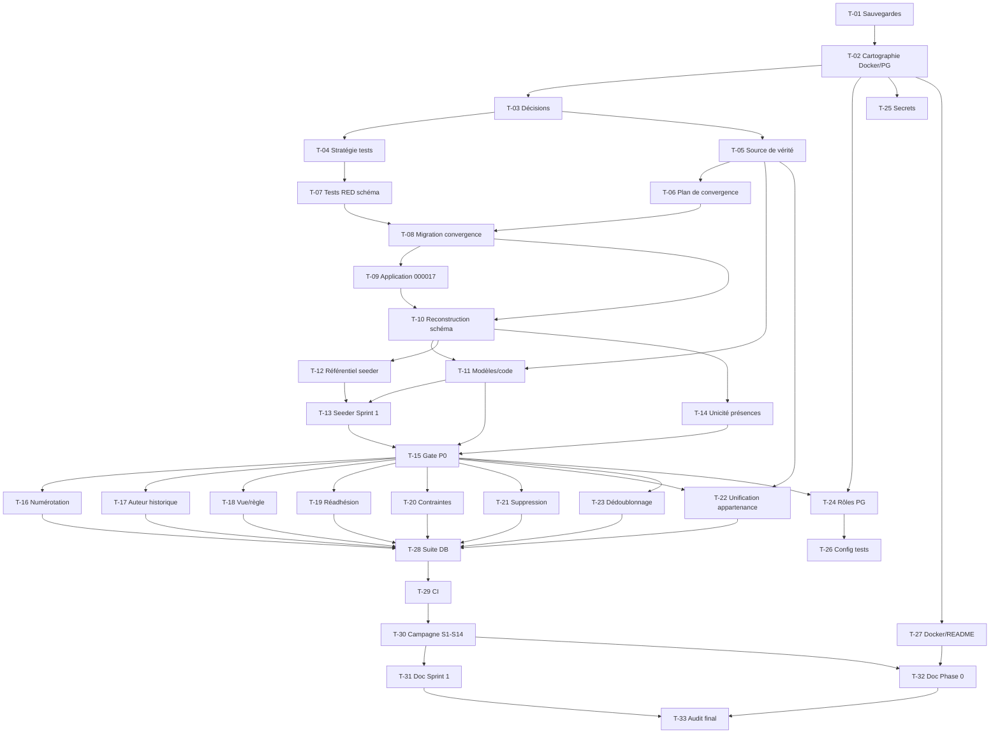

# PLAN DE RÉSOLUTION DES INCOHÉRENCES — ERP ÉGLISE

**Projet** : ERP Église — Centre Impact Chrétien
**Périmètre** : responsabilités de Bienvenu (PostgreSQL, migrations, modèles métier, seeders, triggers/fonctions/séquences/vues, tests de la couche données, Docker/PostgreSQL, documentation technique et traçabilité Git associées)
**Document de référence** : `docs/AUDIT_PERIMETRE_BIENVENU_ERP_EGLISE.txt` (audit en lecture seule du 31/10/2026)
**Version du plan** : 1.0
**Date** : 1er novembre 2026
**Statut** : **PLANIFICATION — AUCUNE CORRECTION EXÉCUTÉE**
**Commit de référence** : `33cf5fdacc12077a637eaa59b95541d53d2bbbd5` (branche `develop`)
**Bases de référence** : `erp_eglise` (développement) et `erp_eglise_test` (tests)

> **Avertissement**
> Ce document est un plan. Il ne décrit **aucune correction réalisée**. Aucune migration, aucun seeder, aucun test applicatif, aucune commande Docker, aucune écriture PostgreSQL n'a été exécuté pour le produire. Les résultats annoncés sont des **résultats attendus**, jamais des résultats observés. Toute opération à risque devra être précédée d'une autorisation explicite et d'une sauvegarde vérifiée.

---

## 0. Comment lire ce document

| Chapitre | Contenu | Usage |
|---|---|---|
| 1 | Résumé de l'audit et état de référence | Comprendre le point de départ |
| 2 | Principes directeurs et politique TDD | Règles de travail obligatoires |
| 3 | Cinq rôles et matrice de responsabilité | Savoir qui fait quoi |
| 4 | Découpage en phases et conditions de passage | Savoir dans quel ordre travailler |
| 5 | Registre des 35 anomalies `AUD-*` | Traiter chaque constat |
| 6 | Fiches détaillées des tâches `T-*` | Exécuter une tâche sans réinventer le cadre |
| 7 | Scénarios de validation `S1` à `S14` | Démontrer les résultats |
| 8 | Dépendances, parallélisation, blocages | Ordonnancer |
| 9 | Protection des données, Docker, PostgreSQL, tests | Ne rien casser |
| 10 | Modèle de rapport de phase | Documenter chaque étape |
| 11 | Décisions humaines `D-01` à `D-10` | Arbitrer avant de corriger |
| 12 | Revue finale du plan | Vérifier la qualité du plan |
| 13 | Matrices de couverture | Prouver que rien n'est oublié |
| 14 | Conditions de démarrage de la première correction | Cadrer la suite |

**Convention de statut** : `PLANIFIÉ` / `EN ATTENTE D'UNE DÉCISION` / `EN ATTENTE D'UNE DÉPENDANCE` / `EN ATTENTE D'UNE VÉRIFICATION` / `À REQUALIFIER`. Aucun statut ne signifie « corrigé ».

---

## 1. Résumé de l'audit initial et état de référence

### 1.1 Objet et périmètre de l'audit

L'audit du 31/10/2026 a examiné en lecture seule : les 18 migrations, les modèles Eloquent de la couche métier, les trois seeders, les triggers/fonctions/séquences/vues PostgreSQL, les tests de la couche données, la documentation technique DB et la configuration Docker/PostgreSQL associée. L'API et le frontend n'ont été examinés qu'en tant que dépendances de contrat de données.

### 1.2 État de référence Git et bases

| Élément | État observé le 31/10/2026 |
|---|---|
| Branche | `develop` |
| HEAD | `33cf5fd` — « Corrections effectuées (périmètre Bienvenu uniquement) » |
| Arbre de travail | Propre (`git status --porcelain=v1` vide) |
| Base `erp_eglise` | 17 migrations appliquées (batch 1) ; `membre.famille_impact_id` encore présente ; `idx_membre_famille_impact` présent ; séquence `seq_numero_membre_2026` absente ; trigger `generer_numero_membre` encore en `COUNT(*)` ; 000017 **non appliquée** |
| Base `erp_eglise_test` | 18 migrations appliquées ; `membre.famille_impact_id` absente ; `famille_disciple`, `composition_famille_disciple` et la vue présents |
| Données `erp_eglise` | 65 membres, 25 familles, 72 relations, 6 familles d'impact, 46 affectations, 251 présences, 12 historiques, 1 département, 1 site |
| Anomalies de données | 3 dates d'intégration futures (max 2026-12-26) ; 14 inactifs/archivés avec affectation active ; 2 doublons de présence ; 12/12 historiques sans auteur |
| Stack Docker | Conteneurs `erp-*` en cours, alors que `docker-compose.yml` déclare des noms `erp_centre_impact_chr-tienne-*` et d'autres ports |
| Rôle PostgreSQL applicatif | `erp_user` : SUPERUSER, CREATEDB, CREATEROLE, BYPASSRLS |

### 1.3 Synthèse des constats par gravité

| Gravité | Nombre | Identifiants |
|---|---|---|
| CRITIQUE | 3 | AUD-001, AUD-002, AUD-003 |
| ÉLEVÉ | 6 | AUD-004 à AUD-009 |
| MOYEN | 17 | AUD-010 à AUD-026 |
| FAIBLE | 9 | AUD-027 à AUD-035 |

Les trois constats critiques sont liés : une colonne supprimée dans le code mais encore utilisée, une migration modifiée après application, et une migration jamais appliquée en développement. Ils forment le bloc P0 « reconstruction non fonctionnelle ».

### 1.4 Faits confirmés, hypothèses et points à vérifier

| Catégorie | Élément | Preuve / raison |
|---|---|---|
| **Confirmé** | `famille_impact_id` est encore dans `Membre::$fillable`, le seeder et trois services | Lecture du code + exécution PHP ciblée |
| **Confirmé** | La migration 000010 a été modifiée après application | Table `migrations` (batch 1) + schéma et `pg_proc` observés |
| **Confirmé** | La migration 000017 est absente de `erp_eglise` | `to_regclass(...)` = NULL |
| **Confirmé** | Aucun seeder ne crée de site ni de département | Recherche exhaustive dans `database/seeders` |
| **Confirmé** | Les 12 historiques ont `change_par IS NULL` | Requête SQL lecture seule |
| **Confirmé** | `erp_user` est SUPERUSER et BYPASSRLS | `pg_roles` |
| **Confirmé** | La stack Docker en cours diffère du fichier | `docker ps`, `docker inspect`, `docker compose ps` |
| **Hypothèse** | Les conteneurs ont été créés à partir d'une version antérieure du même fichier | Labels Compose pointant vers le même chemin, création 11 jours avant |
| **Hypothèse** | L'API est le seul consommateur de `appartenir_famille` | Aucun usage frontend démontré |
| **Hypothèse** | Le trigger `COUNT(*)` provoque une collision après suppression | Raisonnement PostgreSQL, non exécuté |
| **Hypothèse** | La mise à jour de la « dernière » ligne d'historique est fragile en concurrence | Analyse du code, non reproduit |
| **À vérifier** | Comportement réel de `migrate:fresh` vis-à-vis de la séquence autonome | Non exécuté (destructif) |
| **À vérifier** | Intention réelle derrière l'absence de 000017 en dev | Peut être un travail en cours, pas nécessairement un oubli |
| **À vérifier** | Périmètre fonctionnel exact du dédoublonnage attendu | Aucune spécification écrite retrouvée |
| **À vérifier** | Qui consomme `appartenir_famille` (API, frontend, scripts) | Nécessite un inventaire inter-équipes |
| **À vérifier** | Volume et criticité des données de dev à préserver | Aucune politique de données de dev documentée |

### 1.5 Contradictions et limites du rapport d'audit

- **AUD-011** : le rapport affirme une désynchronisation, mais ne prouve pas quelle version du fichier a créé les conteneurs. Le plan traite ce point comme une **vérification préalable obligatoire** (T-02), pas comme un fait définitif.
- **AUD-012** : le comportement de la séquence après `migrate:fresh` est **probable**, non observé. Le plan prévoit un test dédié (S3) en environnement isolé.
- **AUD-025** : le risque de concurrence est **probable**, non reproduit. Il est planifié comme test de charge/concurrence (S4).
- **AUD-031** et **AUD-034** : ces constats sont de simples optimisations ou conventions. Ils sont marqués `À REQUALIFIER` : ils peuvent être clos par une décision documentée sans modification de code.
- **AUD-003** : l'absence de 000017 en dev peut être volontaire (développement en cours). La correction doit d'abord confirmer l'intention auprès du responsable.
- Le rapport ne couvre pas les performances à grande échelle, la conformité RGPD, ni la sécurité applicative (auth, injection). Ces sujets sont hors périmètre et signalés comme tels.

---

## 2. Principes directeurs et politique TDD

### 2.1 Principes

1. **Aucune migration appliquée n'est modifiée rétroactivement.** Toute évolution passe par une nouvelle migration additive et idempotente.
2. **Une seule source de vérité par concept métier.** Toute duplication (colonne, table, service) est explicitement arbitrée avant correction.
3. **Aucune correction sans test rouge préalable** (quand le comportement est automatisable).
4. **Aucune opération destructive sans sauvegarde vérifiée et autorisation explicite.**
5. **Les tests ne touchent jamais la base de développement.** Seules des bases dédiées `_test` ou `_audit` sont utilisées.
6. **Aucune affirmation de réussite sans preuve exécutée** : commande, sortie, assertion, donnée observée.
7. **Séparation des responsabilités** : celui qui conçoit, celui qui code, celui qui teste et celui qui audite ne se confondent pas.
8. **Petits lots, commits atomiques, retour arrière possible à chaque étape.**

### 2.2 Politique TDD obligatoire

Pour chaque tâche qui modifie du code de production :

| Étape | Responsable | Preuve exigée |
|---|---|---|
| **RED** | R4 Tests | Test écrit puis exécuté ; échec **pour la raison comportementale attendue** (pas une erreur de configuration) |
| **GREEN** | R3 Développement | Implémentation minimale ; test RED devient vert |
| **REFACTOR** | R3 + R4 | Tests rerun, toujours verts ; aucune régression |
| **REGRESSION** | R4 | Suite pertinente exécutée ; échecs analysés |
| **AUDIT** | R5 | Vérification indépendante des preuves (commandes, sorties, fichiers) |

- Un test qui échoue pour une mauvaise raison (base absente, dépendance manquante) **ne constitue pas un RED valide**.
- Le développeur ne peut pas affaiblir un test pour le faire passer.
- Le testeur ne modifie pas le code de production.
- Les tâches de documentation ou de configuration sans comportement automatisable sont validées par une **revue humaine structurée** et des commandes de vérification (pas de TDD artificiel).

### 2.3 Definition of Done (commune)

Une tâche est terminée lorsque : code revu, tests RED/GREEN prouvés, tests de régression exécutés, critères d'acceptation vérifiés, documentation mise à jour, preuves archivées, retour arrière décrit, et rapport de phase rédigé.

---

## 3. Les cinq rôles et la matrice de responsabilité

| Rôle | Agent | Missions | Ne fait pas |
|---|---|---|---|
| **R1 — Coordination et planification** | Coordinateur de mission | Plan, arbitrages, dépendances, rapports de phase, coordination documentaire, gate de phase | Ne code pas, ne valide pas seul une correction technique |
| **R2 — Architecture et analyse technique** | `architecte` | Schéma cible, stratégie de migration, décisions techniques, revue de conception | Ne valide pas seul son propre design, ne code pas en production |
| **R3 — Développement et conception des corrections** | `developpeur` | Migrations, modèles, seeders, services, configuration, tests unitaires ciblés | Ne valide pas seul son propre travail, ne modifie pas les tests pour les faire passer |
| **R4 — Tests et validation** | `testeur` | Écriture des tests RED, exécution, scénarios S1–S14, preuves de non-régression | Ne modifie pas le code de production |
| **R5 — Audit, sécurité et contrôle qualité** | `auditeur` (appui ponctuel `security-reviewer`) | Revue indépendante, sécurité PostgreSQL/secrets, vérification des preuves, verdict de phase | Ne corrige pas lui-même ; ne valide pas sans preuve |

### 3.1 Règles de séparation

- Une tâche est **réalisée** par R3, **testée** par R4, **revue** par R5, **pilotée** par R1. R2 intervient en amont sur la conception.
- R5 ne peut pas valider une tâche qu'il a lui-même réalisée.
- R4 participe à la définition des critères d'acceptation **dès la conception**, pas seulement à la fin.
- Les décisions de sécurité (rôles PostgreSQL, secrets, Docker) sont obligatoirement revues par R5.

### 3.2 Matrice synthétique

| Activité | R1 | R2 | R3 | R4 | R5 |
|---|---|---|---|---|---|
| Plan et arbitrages | **R** | C | I | C | C |
| Schéma cible et migrations | A | **R** | C | C | C |
| Implémentation | A | C | **R** | C | I |
| Tests et scénarios | A | I | C | **R** | C |
| Revue sécurité | A | C | I | C | **R** |
| Rapport de phase | **R** | C | C | C | **V** |
| Gate de phase | **R** | C | I | C | **V** |

`R` = responsable, `C` = consulté/contributeur, `A` = arbitre, `I` = informé, `V` = validateur indépendant.

---

## 4. Découpage en phases

### 4.1 Vue d'ensemble

| Phase | Objectif | Tâches | Constats principaux | Gate de sortie |
|---|---|---|---|---|
| **0 — Sécurisation et préparation** | Protéger, cartographier, décider, outiller les tests | T-01 → T-04 | Transverse | Sauvegardes vérifiées, environnements identifiés, décisions cadrées, stratégie de tests approuvée |
| **1 — Architecture et convergence** | Trancher la source de vérité et le schéma cible | T-05 → T-06 | AUD-001, 002, 006, 014, 022 | Décisions `D-01`,`D-02`,`D-03`,`D-09`,`D-10` documentées et approuvées |
| **2 — Migrations et reconstruction du schéma** | Rendre le schéma reproductible et converger la base existante | T-07 → T-10 | AUD-002, 003, 012, 013, 031 | Schéma cible identique sur base neuve et après convergence ; contrôles d'intégrité OK |
| **3 — Modèles, services, seeders** | Aligner le code et les données de référence | T-11 → T-15 | AUD-001, 004, 015, 016, 017, 018, 028, 033 | `migrate:fresh --seed` vert sur base isolée ; API P0 non régressée |
| **4 — Intégrité, triggers, historique** | Fiabiliser les règles métier | T-16 → T-23 | AUD-005, 006, 012, 014, 019 à 025, 029, 030 | Toutes les invariants métier testés et prouvés |
| **5 — Sécurité et environnements** | Réduire les privilèges, protéger les secrets, aligner Docker | T-24 → T-27 | AUD-009, 010, 011, 026, 035 | Rôle applicatif non superuser ; aucun secret réel versionné ; stack alignée ou procédure approuvée |
| **6 — Tests, CI, validation complète** | Exécuter S1–S14 et automatiser | T-28 → T-30 | AUD-007 | Tous les scénarios exécutés ou explicitement bloqués avec preuve |
| **7 — Documentation et clôture** | Rendre la documentation conforme aux preuves | T-31 → T-33 | AUD-008, 032, 034 | Documentation sans affirmation non prouvée ; audit final PASS |

### 4.2 Phase 0 — Sécurisation et préparation

**Objectif** : établir un état de référence fiable, protéger les données, cartographier Docker/PostgreSQL, cadrer les décisions et outiller des tests isolés.

- **Constats concernés** : transverse (AUD-011 pour la cartographie, AUD-032 pour la gouvernance Git).
- **Tâches** : T-01 (sauvegardes), T-02 (cartographie Docker/PG), T-03 (cadrage des décisions), T-04 (stratégie de tests isolés).
- **Responsables** : R1 pilote ; R3 exécute les sauvegardes et la cartographie ; R2 analyse ; R4 conçoit l'isolation ; R5 vérifie.
- **Dépendances** : aucune (point d'entrée).
- **Livrables** : inventaire des conteneurs/volumes/réseaux/ports ; dumps vérifiés ; document de décisions ; plan de tests isolés.
- **Tests** : restauration d'un dump sur une base scratch (preuve de sauvegarde) ; `docker compose config` ; inventaire SQL des objets.
- **Critères d'acceptation** : un dump restauré contient les mêmes comptages que la source ; un seul conteneur PostgreSQL par volume ; base `_audit` identifiée ; décisions D-01 à D-10 listées.
- **Risques** : manipuler Docker peut recréer des conteneurs ; ne jamais faire `down -v` ; ne jamais supprimer un volume.
- **Gate** : sauvegardes restaurées avec succès + environnements identifiés + décisions cadrées + stratégie de tests approuvée. **Aucun code modifié.**

### 4.3 Phase 1 — Architecture et stratégie de convergence

**Objectif** : trancher la source de vérité de l'appartenance aux familles d'impact, définir le schéma cible, la stratégie de migration additive et le traitement des données existantes.

- **Constats** : AUD-001, AUD-002, AUD-006, AUD-014, AUD-019, AUD-022, AUD-023.
- **Tâches** : T-05 (source de vérité + schéma cible), T-06 (plan de convergence + données + nommage).
- **Responsables** : R2 conçoit ; R1 arbitre ; R5 revue ; R3 et R4 consultés.
- **Dépendances** : T-03 (décisions cadrées), T-02 (environnements connus).
- **Livrables** : ADR « source de vérité famille d'impact », schéma cible, plan de convergence, règles de traitement des données.
- **Tests** : revue de conception (checklist), simulation de scénarios de convergence sur papier.
- **Critères** : chaque décision structurante a une justification, un impact et une alternative ; aucune migration rétroactive prévue ; les données invalides ont une règle de traitement.
- **Risques** : décision implicite = dette ; changer d'avis après implémentation = reprise.
- **Gate** : ADR approuvées par R1 + R5 ; `D-01`, `D-02`, `D-03`, `D-09`, `D-10` tranchées.

### 4.4 Phase 2 — Reconstruction reproductible et cohérence des migrations

**Objectif** : produire un schéma cible reproductible, converger une base existante sans perte, vérifier séquences/fonctions/triggers/vues.

- **Constats** : AUD-002, AUD-003, AUD-012, AUD-013, AUD-031.
- **Tâches** : T-07 (tests RED schéma), T-08 (migration de convergence), T-09 (000017), T-10 (reconstruction schéma + contrôles).
- **Responsables** : R3 implémente ; R4 tests ; R5 audit ; R2 revue.
- **Dépendances** : T-05, T-06, T-01.
- **Livrables** : migration(s) additive(s), tests de schéma, rapport de reconstruction.
- **Tests** : migrations sur base vide ; convergence depuis un dump de `erp_eglise` ; comparaison de schéma ; assertions sur séquences/triggers/vues.
- **Critères** : schéma identique sur les deux chemins ; `down()` propre ; aucune perte de données ; contrôles d'intégrité OK.
- **Risques** : perte de données si `migrate:fresh` sur dev ; séquence non supprimée ; trigger dépendant d'une table ultérieure.
- **Gate** : reconstruction schéma verte + convergence verte + diff de schéma vide. **Aucun seed encore.**

### 4.5 Phase 3 — Modèles, services et données de référence

**Objectif** : aligner modèles/services sur le schéma cible, corriger les seeders, prouver `migrate:fresh --seed` et la non-régression API P0.

- **Constats** : AUD-001, AUD-004, AUD-015, AUD-016, AUD-017, AUD-018, AUD-028, AUD-033.
- **Tâches** : T-11 (modèles/code), T-12 (référentiel site/départements), T-13 (seeder Sprint 1), T-14 (unicité présences), T-15 (gate de reconstruction complète).
- **Responsables** : R3 ; R4 ; R5 ; R2.
- **Dépendances** : T-10, T-05, T-06.
- **Livrables** : code aligné, seeders idempotents, jeu de données reproductible, preuve P0.
- **Tests** : S1, S2, S9, S10, S13 ; tests de mass assignment ; tests API.
- **Critères** : plus aucune référence à une colonne supprimée ; `migrate:fresh --seed` sort en 0 ; 65 membres, 25 familles, 6 familles d'impact, 3 familles de disciples ; API P0 verte.
- **Risques** : casser l'API de JF ; seeder qui écrase des données ; dépendance à un département créé manuellement.
- **Gate** : S1, S2, S9, S10, S13 verts sur base isolée.

### 4.6 Phase 4 — Intégrité métier, triggers et historique

**Objectif** : fiabiliser numérotation, historisation, affectations, complétude des Familles des Disciples, doublons et suppression.

- **Constats** : AUD-005, AUD-006, AUD-012, AUD-014, AUD-019 à AUD-025, AUD-029, AUD-030.
- **Tâches** : T-16 à T-23.
- **Responsables** : R3 ; R4 ; R5 ; R2.
- **Dépendances** : T-15.
- **Livrables** : fonctions/triggers corrigés, contraintes, vue corrigée, politique de suppression, unification de l'appartenance, dédoublonnage.
- **Tests** : S3 à S8, S11, S12.
- **Critères** : chaque invariant a un test ; aucune violation possible ; comportement documenté sous concurrence et pour les cas limites.
- **Risques** : verrous, temps de migration, données historiques invalides, changement de contrat API.
- **Gate** : tous les invariants prouvés ; aucune régression sur S1–S14 déjà exécutés.

### 4.7 Phase 5 — Sécurité et configuration des environnements

**Objectif** : réduire les privilèges PostgreSQL, externaliser les secrets, unifier la configuration de test, aligner Docker et la documentation d'exploitation.

- **Constats** : AUD-009, AUD-010, AUD-011, AUD-026, AUD-035.
- **Tâches** : T-24 à T-27.
- **Responsables** : R3 ; R5 (sécurité) ; R2 ; R1.
- **Dépendances** : T-10 (l'application doit fonctionner), T-02 (cartographie), `D-05`, `D-06`, `D-07`.
- **Livrables** : rôles PG, secrets externalisés, configuration unique, Compose/README alignés.
- **Tests** : S14 ; smoke API ; `git grep` de secrets ; `docker compose config`.
- **Critères** : rôle applicatif non superuser ; aucun secret réel versionné ; un seul point de configuration des tests ; Docker décrit la stack ou procédure d'arrêt/reprise approuvée.
- **Risques** : perte d'accès si les droits sont mal retirés ; recréation de conteneurs ; volumes partagés.
- **Gate** : S14 vert + aucun secret + stack documentée/alignée.

### 4.8 Phase 6 — Tests, CI et validation complète

**Objectif** : compléter la suite de tests, l'intégrer en CI et exécuter la campagne S1–S14 avec preuves.

- **Constats** : AUD-007 (et validation de tous les autres).
- **Tâches** : T-28 (suite DB), T-29 (CI), T-30 (campagne).
- **Responsables** : R4 ; R3 ; R5 ; R1.
- **Dépendances** : T-15, T-23, T-27.
- **Livrables** : suite automatisée, pipeline CI, rapport de campagne.
- **Tests** : S1–S14 ; non-régression complète.
- **Critères** : chaque scénario a un statut (réussi/échoué/bloqué/non exécuté) avec preuve ; CI verte sur PR.
- **Risques** : tests instables, dépendance à Docker, fuite de secrets dans les logs.
- **Gate** : rapport de campagne complet ; aucun scénario P0 non exécuté sans justification.

### 4.9 Phase 7 — Documentation et clôture

**Objectif** : mettre la documentation en conformité avec les preuves et clôturer l'audit.

- **Constats** : AUD-008, AUD-032, AUD-034.
- **Tâches** : T-31, T-32, T-33.
- **Responsables** : R1 (documentation) ; R3 (contenu technique) ; R5 (validation).
- **Dépendances** : T-30.
- **Livrables** : documentation corrigée, procédures d'exploitation, rapport d'audit final.
- **Tests** : revue croisée doc ↔ preuves ; vérification que chaque affirmation a une source.
- **Critères** : aucune affirmation de validation sans preuve ; procédures de sauvegarde/restauration/rollback documentées.
- **Risques** : documentation qui vieillit immédiatement ; oubli de mise à jour après correction.
- **Gate** : audit final PASS ; aucun P0/P1 ouvert.

---

## 5. Registre des 35 anomalies `AUD-001` à `AUD-035`

Chaque fiche indique la phase, la ou les tâches, le responsable, les dépendances, les décisions préalables, les composants, les tests, le résultat attendu, les critères mesurables, le risque de régression, la sauvegarde/rollback, l'autorisation et le statut de planification.

### AUD-001 — CRITIQUE — `EN ATTENTE D'UNE DÉCISION`
**Problème** : `membre.famille_impact_id` a été retiré du fichier de migration mais reste dans `Membre::$fillable` (l. 19-23), la relation `familleImpact()` (l. 37-40), le seeder (l. 124) et trois services (`MembreService` l. 66, `SuiviMembreService` l. 38/41/91). La ressource API l'expose (l. 20) et la requête l'accepte (l. 19/33).
**Objectif** : supprimer toute référence à la colonne (ou restaurer la colonne si D-01 le décide), avec un contrat API explicite.
**Phase / tâche** : Phase 3 / T-11.
**Responsable** : R3. **Revue** : R2 + R5. **Validation** : R4 (tests) + R5 (preuves).
**Dépendances** : T-05, T-06, T-08. **Décisions** : D-01, D-10.
**Composants** : `app/Models/Membre.php`, `database/seeders/Sprint1MembresFamillesSeeder.php`, `app/services/Sprint1/MembreService.php`, `app/services/Sprint1/SuiviMembreService.php`, `app/Http/Resources/Sprint1/MembreResource.php`, `app/Http/Requests/Sprint1/StoreMembreRequest.php`, `tests/Feature/Sprint1/Sprint1Test.php`.
**Tests** : concevoir un test de mass assignment (l'attribut ne doit plus être conservé) + S2. Exécuter plus tard sur base isolée.
**Résultat attendu** : aucun code applicatif ne référence `famille_impact_id` ; POST membre et affectation famille d'impact réussissent sur un schéma sans la colonne.
**Critères mesurables** : `git grep -n "famille_impact_id" -- backend/app backend/database` → 0 occurrence hors migration historique ; S2 → 201 ; S1 → exit 0.
**Risque de régression** : contrat API cassé si le champ `familleImpactId` est consommé par le frontend.
**Sauvegarde / rollback** : dump préalable ; revert du commit de correction ; restauration du dump.
**Autorisation** : standard (code). **Difficulté** : moyenne.

### AUD-002 — CRITIQUE — `EN ATTENTE D'UNE DÉCISION`
**Problème** : migration `000010` modifiée après application (colonne retirée, séquence ajoutée, fonction remplacée). La base de dev conserve l'ancien schéma et ne rejouera pas la migration (batch 1).
**Objectif** : garantir une convergence non destructive et une reproductibilité sur base neuve, sans modifier rétroactivement une migration appliquée.
**Phase / tâche** : Phase 2 / T-08.
**Responsable** : R3. **Revue** : R2 + R5. **Validation** : R4 + R5.
**Dépendances** : T-05, T-06, T-01. **Décisions** : D-02.
**Composants** : nouvelle migration additive, `2026_09_15_000010_create_erp_membre_table.php` (figée), table `migrations`, fonctions/triggers.
**Tests** : concevoir des tests de migration (base vide + convergence depuis dump). Exécuter plus tard en base isolée.
**Résultat attendu** : base neuve et base convergée produisent le même schéma cible ; aucune donnée perdue.
**Critères mesurables** : diff de schéma vide entre les deux chemins ; `migrate` idempotent ; `git grep` ne montre aucune modification de 000010 après ce plan.
**Risque de régression** : migration non idempotente, verrous, perte de données.
**Sauvegarde / rollback** : dump `-Fc` + test de restauration ; `down()` de la migration additive ; restauration du dump.
**Autorisation** : **explicite** pour toute DDL sur `erp_eglise`. **Difficulté** : élevée.

### AUD-003 — CRITIQUE — `PLANIFIÉ`
**Problème** : migration `000017` non appliquée dans `erp_eglise` ; `famille_disciple`, `composition_famille_disciple` et la vue sont absents, alors que les modèles et le seeder les utilisent.
**Objectif** : appliquer la migration sur l'environnement de dev après sauvegarde, et vérifier les objets.
**Phase / tâche** : Phase 2 / T-09.
**Responsable** : R3. **Revue** : R2. **Validation** : R4 + R5.
**Dépendances** : T-01, T-08. **Décisions** : D-07 (autorisation d'exécution).
**Composants** : `2026_09_15_000017_create_familles_disciples.php`, base `erp_eglise`.
**Tests** : concevoir S12 (vue) et un contrôle de présence des objets. Exécuter après autorisation.
**Résultat attendu** : `to_regclass` non NULL pour les deux tables et la vue ; `SELECT` sur la vue OK.
**Critères mesurables** : 3 objets présents ; 0 erreur SQL ; `migrations` contient 000017.
**Risque de régression** : migration qui échoue à mi-chemin ; dépendance à `departement`.
**Sauvegarde / rollback** : dump avant ; `down()` de 000017 ; restauration.
**Autorisation** : **explicite** (DDL sur base de dev). **Difficulté** : faible.

### AUD-004 — ÉLEVÉ — `PLANIFIÉ`
**Problème** : aucun seeder ne crée de site ni de département. L'étape 8 du seeder Sprint 1 est donc silencieusement ignorée sur base neuve.
**Objectif** : créer un référentiel site/départements idempotent, exécuté avant le seeder Sprint 1.
**Phase / tâche** : Phase 3 / T-12.
**Responsable** : R3. **Revue** : R2. **Validation** : R4 + R5.
**Dépendances** : T-10. **Décisions** : D-09 (données de référence).
**Composants** : nouveau seeder de référentiel, `DatabaseSeeder`, `Sprint1MembresFamillesSeeder` (garde).
**Tests** : S1, S6, S10. Exécuter sur base isolée.
**Résultat attendu** : 1 site et ≥ 2 départements actifs après seed ; 3 familles de disciples créées.
**Critères mesurables** : `count(site) >= 1`, `count(departement WHERE actif) >= 2`, `count(famille_disciple) = 3`.
**Risque de régression** : doublons de référentiel ; dépendance à des données créées manuellement.
**Sauvegarde / rollback** : seed idempotent (`updateOrCreate`) ; aucun effacement.
**Autorisation** : standard + exécution sur base isolée. **Difficulté** : faible.

### AUD-005 — ÉLEVÉ — `PLANIFIÉ`
**Problème** : `change_par` n'est jamais renseigné. Le trigger insère `NULL` en dur ; le seeder tente `change_par` sur `membre` (colonne inexistante, non fillable). 12/12 historiques ont `NULL`.
**Objectif** : propager l'auteur de façon fiable (contexte de session lu par le trigger, ou insertion applicative transactionnelle).
**Phase / tâche** : Phase 4 / T-17.
**Responsable** : R3. **Revue** : R2. **Validation** : R4 + R5.
**Dépendances** : T-15. **Décisions** : D-02 (mécanisme).
**Composants** : fonction `enregistrer_historique_statut_membre`, `MembreService`, seeder, `historique_statut_membre`.
**Tests** : S5 + test de concurrence S4. Exécuter sur base isolée.
**Résultat attendu** : tout nouveau changement de statut porte l'utilisateur ; aucun `NULL` non justifié.
**Critères mesurables** : `count(*) FILTER (WHERE change_par IS NULL) = 0` pour les nouvelles lignes ; API PATCH → auteur correct.
**Risque de régression** : trigger qui échoue si le contexte n'est pas défini ; historique du seeder.
**Sauvegarde / rollback** : `CREATE OR REPLACE FUNCTION` réversible ; dump.
**Autorisation** : standard. **Difficulté** : moyenne.

### AUD-006 — ÉLEVÉ — `EN ATTENTE D'UNE DÉCISION`
**Problème** : la règle « au moins 1 membre de chaque département actif » repose sur un `departement_origine_id` déclaré librement, jamais recoupé avec `affecter_departement` ; la vue ne filtre ni le statut du membre ni `date_fin`.
**Objectif** : garantir la règle par une vérification réelle et une sémantique explicite (D-10).
**Phase / tâche** : Phase 4 / T-18.
**Responsable** : R2 (conception) + R3. **Revue** : R5. **Validation** : R4 + R5.
**Dépendances** : T-15. **Décisions** : D-10.
**Composants** : `2026_09_15_000017...` (vue), nouvelle migration de vue, éventuel service de composition.
**Tests** : S6, S7, S12. Exécuter sur base isolée.
**Résultat attendu** : déclaration non vérifiée → INCOMPLET ; appartenance réelle → comptée ; cas 0 département défini.
**Critères mesurables** : 3 cas de test (déclaré seul, réel, 0 actif) avec résultats explicites.
**Risque de régression** : faux INCOMPLET si la source d'affectation n'est pas fiable.
**Sauvegarde / rollback** : ancienne vue conservée en `down()` ; dump.
**Autorisation** : standard. **Difficulté** : élevée.

### AUD-007 — ÉLEVÉ — `PLANIFIÉ`
**Problème** : aucun test automatisé de la couche DB (migrations, triggers, contraintes, vues, seeders) ; aucune CI ; 1 seule méthode pour le Sprint 1 (sur 69).
**Objectif** : suite de tests DB complète + pipeline CI.
**Phase / tâche** : Phase 6 / T-28, T-29, T-30 (amorçage en T-07).
**Responsable** : R4. **Revue** : R5. **Validation** : R1 + R5.
**Dépendances** : T-15, T-23, T-27. **Décisions** : D-02, D-07.
**Composants** : `backend/tests/Feature/Database/**`, `phpunit.xml`, `.github/workflows/**`, base `_test`/`_audit`.
**Tests** : S1–S14 automatisés autant que possible.
**Résultat attendu** : suite verte en CI ; chaque invariant couvert.
**Critères mesurables** : 100 % des scénarios automatisables exécutés en CI ; 0 test dépendant de `erp_eglise`.
**Risque de régression** : tests instables ; fuite de secrets dans les logs.
**Sauvegarde / rollback** : N/A (tests) ; isolation stricte.
**Autorisation** : standard. **Difficulté** : élevée.

### AUD-008 — ÉLEVÉ — `PLANIFIÉ`
**Problème** : la documentation Sprint 1 contredit le schéma cible (colonne supprimée documentée, 7 migrations vs 8, 6 modèles vs 8, volumétries fausses, « 11 scénarios validés » sans preuve, date erronée).
**Objectif** : réécrire la documentation à partir du schéma et des preuves réelles.
**Phase / tâche** : Phase 7 / T-31 (+ T-32 pour la Phase 0).
**Responsable** : R1. **Revue** : R3. **Validation** : R5.
**Dépendances** : T-30. **Décisions** : aucune.
**Composants** : `backend/docs/SPRINT1_DOCUMENTATION_EQUIPE.md`, `backend/docs/PHASE0_DOCUMENTATION_EQUIPE.md`.
**Tests** : revue croisée doc ↔ code ↔ base (checklist).
**Résultat attendu** : chaque affirmation est sourcée (fichier, ligne, requête).
**Critères mesurables** : 0 affirmation « validé » sans preuve ; volumétries générées par requête ; statuts explicites.
**Risque de régression** : documentation à nouveau obsolète après correction.
**Sauvegarde / rollback** : versionnement Git ; revert du commit doc.
**Autorisation** : standard. **Difficulté** : moyenne.

### AUD-009 — ÉLEVÉ — `EN ATTENTE D'UNE DÉCISION`
**Problème** : `erp_user` est SUPERUSER, CREATEDB, CREATEROLE, BYPASSRLS ; l'application et les tests l'utilisent.
**Objectif** : séparer rôle applicatif, rôle de migration et rôle de test ; réduire les privilèges.
**Phase / tâche** : Phase 5 / T-24.
**Responsable** : R3. **Revue** : R5 (sécurité). **Validation** : R5 + R1.
**Dépendances** : T-10, T-02. **Décisions** : D-06.
**Composants** : `pg_roles`, `docker-compose.yml`, `.env`, migrations de `GRANT`.
**Tests** : S14 + smoke API.
**Résultat attendu** : rôle applicatif sans SUPERUSER/BYPASSRLS ; application fonctionnelle.
**Critères mesurables** : `rolsuper = false`, `rolbypassrls = false` ; S1/S2 verts.
**Risque de régression** : perte d'accès, migrations impossibles.
**Sauvegarde / rollback** : `pg_dumpall -g` ; procédure de re-grant documentée.
**Autorisation** : **explicite** (rôles du cluster). **Difficulté** : moyenne.

### AUD-010 — MOYEN — `EN ATTENTE D'UNE DÉCISION`
**Problème** : identifiants de dev en clair dans `docker-compose.yml`, `phpunit.xml`, `tests/TestCase.php`, `.env.example`, README.
**Objectif** : externaliser, remplacer par des placeholders, faire tourner les secrets.
**Phase / tâche** : Phase 5 / T-25.
**Responsable** : R3. **Revue** : R5. **Validation** : R5.
**Dépendances** : T-02. **Décisions** : D-05.
**Composants** : les cinq fichiers cités.
**Tests** : `git grep` de motifs de secrets ; boot de l'application.
**Résultat attendu** : aucun secret réel versionné.
**Critères mesurables** : 0 correspondance dans le dépôt ; `.env.example` en placeholders ; rotation effectuée.
**Risque de régression** : application non démarrable si les variables manquent.
**Sauvegarde / rollback** : secrets stockés hors dépôt ; restauration de l'ancien `.env` local.
**Autorisation** : **humaine** (rotation). **Difficulté** : faible.

### AUD-011 — MOYEN — `EN ATTENTE D'UNE VÉRIFICATION`
**Problème** : la stack Docker en cours (`erp-*`, 8000→8000, 3000→5173, 5050→80, 5432 publié) diffère du fichier (`erp_centre_impact_chr-tienne-*`, 8000→80, 3000→3000, 8088→80, 5432 non publié).
**Objectif** : déterminer la configuration réelle, sécuriser toute recréation, aligner fichier et stack.
**Phase / tâche** : Phase 0 / T-02 puis Phase 5 / T-27.
**Responsable** : R3 (cartographie), R2 (analyse). **Revue** : R5. **Validation** : R1 + R5.
**Dépendances** : aucune. **Décisions** : D-07.
**Composants** : `docker-compose.yml`, `docker inspect`, volumes/réseaux/ports, README.
**Tests** : `docker compose config`, inventaire des volumes, contrôle d'unicité du volume PostgreSQL.
**Résultat attendu** : une seule stack identifiée ; procédure d'arrêt/reprise sûre ; fichier aligné ou écart documenté.
**Critères mesurables** : 1 conteneur PostgreSQL par volume ; 0 conteneur orphelin après procédure ; `docker compose config` valide.
**Risque de régression** : double montage de volume, perte de données, conflit de ports.
**Sauvegarde / rollback** : dump + snapshot de volume ; conserver les anciens conteneurs arrêtés jusqu'à validation.
**Autorisation** : **explicite** avant toute recréation. **Difficulté** : élevée.

### AUD-012 — MOYEN — `EN ATTENTE D'UNE VÉRIFICATION`
**Problème** : séquence `seq_numero_membre_2026` autonome, non supprimée par `down()` ni par `migrate:fresh` ; nom figé 2026 alors que le préfixe suit l'année courante.
**Objectif** : séquence possédée par la table, nommée sans année, supprimée au rollback ; numérotation monotone.
**Phase / tâche** : Phase 4 / T-16 (création en T-08).
**Responsable** : R3. **Revue** : R2. **Validation** : R4 + R5.
**Dépendances** : T-08, T-15. **Décisions** : D-02.
**Composants** : migration, fonction `generer_numero_membre`, `membre.numero_membre`.
**Tests** : S3, S4. Exécuter en base isolée.
**Résultat attendu** : pas de réutilisation de numéro ; suppression propre.
**Critères mesurables** : après 3 insertions + 1 suppression + 1 insertion → 4 numéros distincts ; `down()` supprime la séquence.
**Risque de régression** : doublons de numéro, blocage d'insertion.
**Sauvegarde / rollback** : `down()` ; dump.
**Autorisation** : standard (DDL en base isolée). **Difficulté** : moyenne.

### AUD-013 — MOYEN — `PLANIFIÉ`
**Problème** : le trigger d'historique (000010) est créé avant la table `historique_statut_membre` (000015).
**Objectif** : déplacer la création du trigger après la table ou ajouter une garde.
**Phase / tâche** : Phase 2 / T-08.
**Responsable** : R3. **Revue** : R2. **Validation** : R4.
**Dépendances** : T-08. **Décisions** : D-02.
**Composants** : migrations 000010/000015, fonction trigger.
**Tests** : migration par étapes + UPDATE entre les deux.
**Résultat attendu** : aucune dépendance à une table non créée.
**Critères mesurables** : migration séquentielle sans erreur ; test d'UPDATE intermédiaire vert.
**Risque de régression** : ordre de migration modifié.
**Sauvegarde / rollback** : `down()` ; dump.
**Autorisation** : standard. **Difficulté** : faible.

### AUD-014 — MOYEN — `EN ATTENTE D'UNE DÉCISION`
**Problème** : trois représentations de l'appartenance famille d'impact : `membre.famille_impact_id`, `appartenir_famille`, `affecter_famille_impact`.
**Objectif** : une source de vérité unique, les autres dépréciées ou supprimées avec migration de convergence.
**Phase / tâche** : Phase 4 / T-22.
**Responsable** : R2 + R3. **Revue** : R5. **Validation** : R4 + R5.
**Dépendances** : T-05. **Décisions** : D-01.
**Composants** : `appartenir_famille`, `affecter_famille_impact`, `AffectationFamilleService`, `SuiviMembreService`, modèles.
**Tests** : parcours API d'affectation ; contrôle de non-divergence.
**Résultat attendu** : une seule table alimentée ; l'autre dépréciée/archivée.
**Critères mesurables** : 0 divergence entre les deux sources après migration ; API verte.
**Risque de régression** : perte d'historique d'affectation.
**Sauvegarde / rollback** : dump ; conserver l'ancienne table en lecture seule.
**Autorisation** : **humaine** (D-01). **Difficulté** : élevée.

### AUD-015 — MOYEN — `EN ATTENTE D'UNE DÉCISION`
**Problème** : aucune unicité sur (`id_affectation`, `date_reunion`) ; 2 doublons observés.
**Objectif** : empêcher les doublons et nettoyer l'existant selon D-09.
**Phase / tâche** : Phase 3 / T-14.
**Responsable** : R3. **Revue** : R2. **Validation** : R4.
**Dépendances** : T-10. **Décisions** : D-09.
**Composants** : migration `presence_famille_impact`, services d'appel.
**Tests** : S9.
**Résultat attendu** : doublon rejeté ou upsert ; 0 doublon après nettoyage.
**Critères mesurables** : contrainte présente ; `GROUP BY ... HAVING count(*) > 1` → 0 ligne.
**Risque de régression** : insertion concurrente.
**Sauvegarde / rollback** : dump ; `down()` de la contrainte.
**Autorisation** : standard. **Difficulté** : faible.

### AUD-016 — MOYEN — `EN ATTENTE D'UNE DÉCISION`
**Problème** : 14 membres inactifs/archivés conservent une affectation active ; le seeder archive des membres affectés.
**Objectif** : clôturer automatiquement les affectations lors du changement de statut ; nettoyer l'existant.
**Phase / tâche** : Phase 3 / T-13.
**Responsable** : R3. **Revue** : R2. **Validation** : R4.
**Dépendances** : T-11, T-12. **Décisions** : D-09.
**Composants** : seeder, service de statut, trigger éventuel.
**Tests** : S6, S11.
**Résultat attendu** : 0 inactif/archivé avec affectation active.
**Critères mesurables** : requête de contrôle → 0 ; nouveau changement de statut → clôture.
**Risque de régression** : clôture trop agressive.
**Sauvegarde / rollback** : dump ; transaction.
**Autorisation** : standard. **Difficulté** : moyenne.

### AUD-017 — MOYEN — `EN ATTENTE D'UNE DÉCISION`
**Problème** : 3 dates d'intégration futures (max 2026-12-26), dues au tirage aléatoire.
**Objectif** : borner la génération et corriger l'existant.
**Phase / tâche** : Phase 3 / T-13.
**Responsable** : R3. **Revue** : R2. **Validation** : R4.
**Dépendances** : T-10. **Décisions** : D-09.
**Composants** : `Sprint1MembresFamillesSeeder` (l. 100-103).
**Tests** : S13.
**Résultat attendu** : 0 date future.
**Critères mesurables** : `count(*) WHERE date_integration > CURRENT_DATE` → 0.
**Risque de régression** : jeu de données modifié.
**Sauvegarde / rollback** : seed idempotent ; dump.
**Autorisation** : standard. **Difficulté** : faible.

### AUD-018 — MOYEN — `PLANIFIÉ`
**Problème** : seeder aléatoire (`rand`, `array_rand`) et non idempotent ; seconde exécution → violation d'unicité, rollback.
**Objectif** : seeder reproductible (seed Faker fixe) et idempotent (`updateOrCreate`, gardes).
**Phase / tâche** : Phase 3 / T-13.
**Responsable** : R3. **Revue** : R2. **Validation** : R4.
**Dépendances** : T-12. **Décisions** : aucune.
**Composants** : `Sprint1MembresFamillesSeeder`, `DatabaseSeeder`.
**Tests** : S10.
**Résultat attendu** : deux exécutions → même état, exit 0.
**Critères mesurables** : comptages identiques après 2 runs ; 0 exception.
**Risque de régression** : données de test figées.
**Sauvegarde / rollback** : base isolée uniquement.
**Autorisation** : standard. **Difficulté** : moyenne.

### AUD-019 — MOYEN — `PLANIFIÉ`
**Problème** : `UNIQUE (id_famille_disciple, id_membre)` interdit la réadhésion après une sortie (`actif = FALSE`, `date_fin` renseignée).
**Objectif** : autoriser une nouvelle adhésion après clôture tout en interdisant les doublons actifs.
**Phase / tâche** : Phase 4 / T-19.
**Responsable** : R3. **Revue** : R2. **Validation** : R4.
**Dépendances** : T-15. **Décisions** : D-02.
**Composants** : `2026_09_15_000017...` (index), nouvelle migration.
**Tests** : S8.
**Résultat attendu** : réadhésion possible ; doublon actif rejeté.
**Critères mesurables** : 1 seul actif par couple ; réadhésion après `date_fin` acceptée.
**Risque de régression** : doublons actifs si l'index partiel est mal défini.
**Sauvegarde / rollback** : `down()` ; dump.
**Autorisation** : standard. **Difficulté** : faible.

### AUD-020 — MOYEN — `PLANIFIÉ`
**Problème** : aucune contrainte `periode_fin >= periode_debut` ni `date_fin >= date_debut` ; `date_debut` nullable.
**Objectif** : ajouter les CHECK et rendre `date_debut` non nullable avec défaut.
**Phase / tâche** : Phase 4 / T-20.
**Responsable** : R3. **Revue** : R2. **Validation** : R4.
**Dépendances** : T-15. **Décisions** : D-02.
**Composants** : `famille_disciple`, `composition_famille_disciple`.
**Tests** : S6, S8 ; tests de rejet.
**Résultat attendu** : périodes incohérentes rejetées.
**Critères mesurables** : 4 CHECK présents ; insert invalide → erreur.
**Risque de régression** : données existantes invalides bloquant la migration.
**Sauvegarde / rollback** : pré-scan des données ; `down()` des contraintes.
**Autorisation** : standard. **Difficulté** : moyenne.

### AUD-021 — MOYEN — `PLANIFIÉ`
**Problème** : `famille_disciple` sans `date_modification` ni index sur `responsable_id` ; `composition_*` sans index sur `actif`/`date_fin`.
**Objectif** : ajouter les index et le suivi de modification.
**Phase / tâche** : Phase 4 / T-20.
**Responsable** : R3. **Revue** : R2. **Validation** : R4.
**Dépendances** : T-15. **Décisions** : D-02.
**Composants** : `famille_disciple`, `composition_famille_disciple`, fonction `update_date_modification`.
**Tests** : assertions de schéma ; `EXPLAIN` indicatif.
**Résultat attendu** : index présents ; `date_modification` maintenue.
**Critères mesurables** : `pg_indexes` contient les index ; trigger présent.
**Risque de régression** : verrouillage lors de la création d'index.
**Sauvegarde / rollback** : `DROP INDEX` documenté ; dump.
**Autorisation** : standard. **Difficulté** : moyenne.

### AUD-022 — MOYEN — `EN ATTENTE D'UNE DÉCISION`
**Problème** : `ON DELETE CASCADE` sur les compositions, alors que le reste du schéma privilégie RESTRICT.
**Objectif** : politique de suppression cohérente et documentée.
**Phase / tâche** : Phase 4 / T-21.
**Responsable** : R2 + R3. **Revue** : R5. **Validation** : R4 + R5.
**Dépendances** : T-15. **Décisions** : D-03.
**Composants** : `composition_famille_disciple`, `famille_disciple`.
**Tests** : S11.
**Résultat attendu** : aucune perte silencieuse d'historique.
**Critères mesurables** : suppression d'un groupe avec compositions → RESTRICT ou archivage ; comportement testé.
**Risque de régression** : suppression bloquée là où elle était permise.
**Sauvegarde / rollback** : dump ; `down()`.
**Autorisation** : **humaine** (D-03). **Difficulté** : moyenne.

### AUD-023 — MOYEN — `EN ATTENTE D'UNE DÉCISION`
**Problème** : le trigger bloque les membres actifs, mais les FK RESTRICT bloquent tout membre avec historique/affectation : suppression de fait impossible après la première historisation.
**Objectif** : assumer une politique (archivage systématique ou suppression contrôlée) et l'outiller.
**Phase / tâche** : Phase 4 / T-21.
**Responsable** : R2 + R3. **Revue** : R5. **Validation** : R4.
**Dépendances** : T-21. **Décisions** : D-03.
**Composants** : triggers, FK, services, documentation.
**Tests** : S11.
**Résultat attendu** : comportement documenté et testé.
**Critères mesurables** : 3 cas (actif, inactif avec historique, sans historique) avec résultat explicite.
**Risque de régression** : suppression accidentelle.
**Sauvegarde / rollback** : dump ; pas de DELETE en masse.
**Autorisation** : **humaine** (D-03). **Difficulté** : moyenne.

### AUD-024 — MOYEN — `EN ATTENTE D'UNE DÉCISION`
**Problème** : dédoublonnage non livré : pas d'email dans `personne`, pas d'unicité nom/téléphone, pas d'endpoint de fusion opérationnel.
**Objectif** : définir la clé de dédoublonnage et la fusion.
**Phase / tâche** : Phase 4 / T-23.
**Responsable** : R2 + R3. **Revue** : R5. **Validation** : R4.
**Dépendances** : T-15. **Décisions** : D-04.
**Composants** : `personne`, services, API, tests.
**Tests** : scénarios de doublon (exact, proche, faux positif).
**Résultat attendu** : détection et fusion tracées.
**Critères mesurables** : 3 scénarios définis ; fusion conserve les références ; 0 perte.
**Risque de régression** : fusion erronée.
**Sauvegarde / rollback** : dump ; fusion réversible (journal).
**Autorisation** : **humaine** (D-04). **Difficulté** : très élevée.

### AUD-025 — MOYEN — `EN ATTENTE D'UNE VÉRIFICATION`
**Problème** : l'auteur est écrit sur « la dernière ligne d'historique », sans corrélation ; risque de mauvaise ligne en concurrence.
**Objectif** : corréler l'insertion et la mise à jour de l'auteur.
**Phase / tâche** : Phase 4 / T-17.
**Responsable** : R3. **Revue** : R2. **Validation** : R4.
**Dépendances** : T-17. **Décisions** : D-02.
**Composants** : `MembreService`, trigger, `historique_statut_membre`.
**Tests** : S4, S5.
**Résultat attendu** : aucune mise à jour de mauvaise ligne.
**Critères mesurables** : test concurrent → 100 % des lignes correctes.
**Risque de régression** : historique incohérent.
**Sauvegarde / rollback** : dump ; revert.
**Autorisation** : standard. **Difficulté** : moyenne.

### AUD-026 — MOYEN — `PLANIFIÉ`
**Problème** : configuration DB dupliquée et figée sur l'hôte `postgres` (`phpunit.xml` + `TestCase.php`) ; tests impossibles hors Docker.
**Objectif** : une seule source de configuration, garde de sécurité sur le nom de base.
**Phase / tâche** : Phase 5 / T-26.
**Responsable** : R3. **Revue** : R2. **Validation** : R4.
**Dépendances** : T-24. **Décisions** : aucune.
**Composants** : `phpunit.xml`, `tests/TestCase.php`, `.env.testing`.
**Tests** : exécution locale et CI.
**Résultat attendu** : configuration unique ; garde `_test`/`_audit`.
**Critères mesurables** : 0 duplication ; démarrage refusé si base non dédiée.
**Risque de régression** : tests qui ne démarrent plus.
**Sauvegarde / rollback** : revert du commit.
**Autorisation** : standard. **Difficulté** : faible.

### AUD-027 — FAIBLE — `PLANIFIÉ`
**Problème** : imports morts (`Site`, `HistoriqueStatutMembre`) et variables inutilisées (`$ancienStatut`, `$familleDisciple`).
**Objectif** : nettoyage statique.
**Phase / tâche** : Phase 3 / T-13.
**Responsable** : R3. **Revue** : R5. **Validation** : R4 (lint).
**Dépendances** : T-11. **Décisions** : aucune.
**Composants** : `Sprint1MembresFamillesSeeder`.
**Tests** : Pint + analyse statique.
**Résultat attendu** : 0 import/variable mort.
**Critères mesurables** : `pint --test` et analyse OK.
**Risque de régression** : nul.
**Sauvegarde / rollback** : revert.
**Autorisation** : standard. **Difficulté** : faible.

### AUD-028 — FAIBLE — `PLANIFIÉ`
**Problème** : `Membre::$casts['actif']` référence une colonne inexistante.
**Objectif** : supprimer le cast fantôme.
**Phase / tâche** : Phase 3 / T-11.
**Responsable** : R3. **Revue** : R2. **Validation** : R4.
**Dépendances** : T-11. **Décisions** : aucune.
**Composants** : `app/Models/Membre.php` (l. 29).
**Tests** : test de sérialisation.
**Résultat attendu** : plus de cast orphelin.
**Critères mesurables** : `getCasts()` ne contient plus `actif`.
**Risque de régression** : nul.
**Sauvegarde / rollback** : revert.
**Autorisation** : standard. **Difficulté** : faible.

### AUD-029 — FAIBLE — `PLANIFIÉ`
**Problème** : alias accentué `nb_departements_représentes` dans la vue.
**Objectif** : alias ASCII stable et correct.
**Phase / tâche** : Phase 4 / T-18.
**Responsable** : R3. **Revue** : R2. **Validation** : R4.
**Dépendances** : T-18. **Décisions** : D-10.
**Composants** : vue `vue_completude_famille_disciple`, consommateurs.
**Tests** : S12.
**Résultat attendu** : colonne `nb_departements_presents`.
**Critères mesurables** : `information_schema.columns` sans accent.
**Risque de régression** : consommateur cassé.
**Sauvegarde / rollback** : ancienne vue en `down()`.
**Autorisation** : standard. **Difficulté** : faible.

### AUD-030 — FAIBLE — `PLANIFIÉ`
**Problème** : `famille_disciple.statut` et `date_creation` nullables malgré un CHECK et un défaut.
**Objectif** : `NOT NULL` avec défauts.
**Phase / tâche** : Phase 4 / T-20.
**Responsable** : R3. **Revue** : R2. **Validation** : R4.
**Dépendances** : T-20. **Décisions** : D-02.
**Composants** : `famille_disciple`.
**Tests** : assertion de schéma.
**Résultat attendu** : colonnes non nullables.
**Critères mesurables** : `is_nullable = 'NO'` pour les deux.
**Risque de régression** : insert sans statut.
**Sauvegarde / rollback** : `down()`.
**Autorisation** : standard. **Difficulté** : faible.

### AUD-031 — FAIBLE — `À REQUALIFIER`
**Problème** : `idx_membre_personne` redondant avec la contrainte UNIQUE `membre_id_personne_key`.
**Objectif** : décider de la suppression ou de la conservation documentée.
**Phase / tâche** : Phase 2 / T-08.
**Responsable** : R2. **Revue** : R5. **Validation** : R4.
**Dépendances** : T-08. **Décisions** : D-02.
**Composants** : `membre`, index.
**Tests** : requête `pg_indexes` + `EXPLAIN`.
**Résultat attendu** : décision documentée ; index supprimé ou justifié.
**Critères mesurables** : 0 index redondant ou justification écrite.
**Risque de régression** : plan de requête modifié.
**Sauvegarde / rollback** : `CREATE INDEX` de restauration.
**Autorisation** : standard. **Difficulté** : faible.

### AUD-032 — FAIBLE — `PLANIFIÉ`
**Problème** : commit `33cf5fd` « périmètre Bienvenu uniquement » contenant AGENTS.md, CLAUDE.md, composer.json/lock, .mcp.json, boost.json, opencode.json, doc Phase 0.
**Objectif** : convention de commits atomiques par périmètre.
**Phase / tâche** : Phase 0 / T-01 (état de référence) + Phase 7 / T-33 (gouvernance).
**Responsable** : R1. **Revue** : R5. **Validation** : R5.
**Dépendances** : aucune. **Décisions** : aucune.
**Composants** : convention d'équipe, futur historique Git.
**Tests** : revue de PR (checklist).
**Résultat attendu** : commits futurs atomiques.
**Critères mesurables** : 1 PR = 1 périmètre ; checklist appliquée.
**Risque de régression** : aucun (documentation).
**Sauvegarde / rollback** : N/A.
**Autorisation** : standard. **Difficulté** : faible.

### AUD-033 — FAIBLE — `PLANIFIÉ`
**Problème** : `FamilleImpact` caste `heure_reunion` en `datetime` sur une colonne `TIME`.
**Objectif** : exposer un format `H:i` sans dépendance à la date du jour.
**Phase / tâche** : Phase 3 / T-11.
**Responsable** : R3. **Revue** : R2. **Validation** : R4.
**Dépendances** : T-11. **Décisions** : aucune.
**Composants** : `app/Models/FamilleImpact.php`, ressource API.
**Tests** : test de sérialisation (valeur stable).
**Résultat attendu** : `"18:30"` stable.
**Critères mesurables** : 3 exécutions à des dates différentes → même sortie.
**Risque de régression** : format API.
**Sauvegarde / rollback** : revert.
**Autorisation** : standard. **Difficulté** : faible.

### AUD-034 — FAIBLE — `À REQUALIFIER`
**Problème** : préfixes numériques `000010`/`000011` réutilisés pour des migrations d'octobre.
**Objectif** : décider entre renommage et acceptation documentée.
**Phase / tâche** : Phase 1 / T-06 (décision) + Phase 7 / T-32 (documentation).
**Responsable** : R2. **Revue** : R1. **Validation** : R5.
**Dépendances** : T-06. **Décisions** : D-08.
**Composants** : noms de fichiers de migration.
**Tests** : `migrate:status` après renommage éventuel.
**Résultat attendu** : décision documentée ; ordre stable.
**Critères mesurables** : ordre de migration identique ; 0 collision.
**Risque de régression** : renommage d'une migration déjà appliquée = dérive.
**Sauvegarde / rollback** : ne pas renommer les migrations appliquées ; décision d'acceptation recommandée.
**Autorisation** : **humaine** (D-08). **Difficulté** : faible.

### AUD-035 — FAIBLE — `PLANIFIÉ`
**Problème** : README obsolète (préfixes de conteneurs, ports).
**Objectif** : régénérer la documentation d'exploitation depuis le Compose réel.
**Phase / tâche** : Phase 5 / T-27.
**Responsable** : R1 + R3. **Revue** : R5. **Validation** : R1.
**Dépendances** : T-27. **Décisions** : D-07.
**Composants** : `README.md`.
**Tests** : checklist doc ↔ stack.
**Résultat attendu** : commandes et ports exacts.
**Critères mesurables** : 0 écart entre README et `docker compose config`.
**Risque de régression** : documentation à nouveau obsolète.
**Sauvegarde / rollback** : revert.
**Autorisation** : standard. **Difficulté** : faible.

---

## 6. Fiches détaillées des tâches `T-01` à `T-33`

**Hypothèses d'estimation** : 1 développeur expérimenté, environnement déjà sauvegardé, pas d'imprévu majeur, revues incluses. Les fourchettes sont indicatives et doivent être réévaluées après la Phase 0. Elles ne constituent pas un engagement.

### T-01 — Gel de l'état de référence et sauvegardes vérifiées
- **Objectif** : figer commit, branches, comptages et schémas ; produire des dumps restaurables de `erp_eglise` et `erp_eglise_test`.
- **Anomalies** : AUD-032 (traçabilité).
- **Phase** : 0.
- **Responsable principal** : R3. **Contributeurs** : R1. **Réviseur** : R2. **Validateur indépendant** : R5.
- **Prérequis** : accès PostgreSQL en lecture et aux volumes Docker.
- **Composants** : `git`, `pg_dump`, volumes Docker, stockage hors dépôt.
- **Risques** : dump incomplet, restauration non testée, stockage dans le dépôt.
- **Tests prévus** : restauration du dump sur une base scratch et comparaison des comptages.
- **Critères mesurables** : dump `-Fc` de chaque base ; restauration OK ; 65/25/72/6/46/251/12/1/1 identiques ; SHA-256 consigné ; fichiers hors dépôt.
- **Livrable** : inventaire d'état + dumps vérifiés + journal de restauration.
- **Effort** : faible (0,5 j-h).
- **Retour arrière** : conserver les dumps ; ne rien supprimer avant la fin de la mission.

### T-02 — Cartographie Docker/PostgreSQL et identification des environnements
- **Objectif** : déterminer la configuration réelle des conteneurs, volumes, réseaux, ports et bases ; distinguer dev, test et audit.
- **Anomalies** : AUD-011.
- **Phase** : 0.
- **Responsable principal** : R3. **Contributeurs** : R2. **Réviseur** : R5. **Validateur indépendant** : R1.
- **Prérequis** : T-01.
- **Composants** : `docker ps`, `docker inspect`, `docker volume ls/inspect`, `docker network ls`, `docker compose config`, `pg_database`.
- **Risques** : confondre deux conteneurs PostgreSQL partageant un volume ; recréer par mégarde.
- **Tests prévus** : contrôle d'unicité conteneur↔volume ; comparaison fichier/stack ; inventaire SQL des bases.
- **Critères mesurables** : 1 conteneur PostgreSQL par volume ; table conteneur/volume/port/base ; base `_audit` identifiée ; aucune commande modificative exécutée.
- **Livrable** : cartographie datée + tableau des écarts + procédure d'arrêt sûre.
- **Effort** : moyen (1-2 j-h).
- **Retour arrière** : aucune modification ; conserver les conteneurs existants.

### T-03 — Cadrage et arbitrage des décisions structurantes
- **Objectif** : formuler `D-01` à `D-10` avec options, conséquences, recommandation ; obtenir les arbitrages humains.
- **Anomalies** : transverse (AUD-001, 002, 006, 009, 010, 014, 022, 023, 024, 034).
- **Phase** : 0.
- **Responsable principal** : R1. **Contributeurs** : R2, R5. **Réviseur** : R2. **Validateur indépendant** : R5.
- **Prérequis** : T-01, T-02.
- **Composants** : document de décisions (hors code), rapport d'audit.
- **Risques** : décision implicite, arbitrage tardif, contradiction entre décisions.
- **Tests prévus** : revue de cohérence des décisions (matrice décision ↔ constat).
- **Critères mesurables** : 10 décisions documentées ; chaque décision a ≥ 2 options, conséquences et recommandation ; statut « approuvée / en attente ».
- **Livrable** : registre de décisions `D-01`–`D-10`.
- **Effort** : moyen (1-2 j-h).
- **Retour arrière** : réviser une décision avant implémentation ; aucune conséquence sur les données.

### T-04 — Stratégie de tests isolés et inventaire de la couverture
- **Objectif** : définir bases `_test`/`_audit`, garde anti-destruction, conventions de tests et inventaire des scénarios automatisables.
- **Anomalies** : AUD-007, AUD-026 (préparation).
- **Phase** : 0.
- **Responsable principal** : R4. **Contributeurs** : R3. **Réviseur** : R2. **Validateur indépendant** : R5.
- **Prérequis** : T-02.
- **Composants** : `phpunit.xml`, `tests/TestCase.php`, `.env.testing`, base `_audit`.
- **Risques** : `RefreshDatabase` sur la base de dev ; tests dépendants de données partagées.
- **Tests prévus** : test de la garde (refus si le nom de base n'est pas dédié) ; smoke test sur base vide.
- **Critères mesurables** : 100 % des tests refusent une base non `_test`/`_audit` ; 14 scénarios classés (auto/manuel) ; 0 accès implicite à `erp_eglise`.
- **Livrable** : plan de tests isolés + inventaire de couverture.
- **Effort** : faible (0,5-1 j-h).
- **Retour arrière** : revert de la configuration de test.

### T-05 — Décision de source de vérité et schéma cible
- **Objectif** : trancher la représentation de l'appartenance famille d'impact ; décrire le schéma cible (tables, colonnes, contraintes, triggers, vues).
- **Anomalies** : AUD-001, AUD-006, AUD-014.
- **Phase** : 1.
- **Responsable principal** : R2. **Contributeurs** : R3, R4. **Réviseur** : R5. **Validateur indépendant** : R1.
- **Prérequis** : T-03, T-02.
- **Composants** : modèle de données, `appartenir_famille`, `affecter_famille_impact`, vue de complétude.
- **Risques** : décision coûteuse à inverser ; impact API non identifié.
- **Tests prévus** : revue de conception ; scénario de convergence sur papier ; inventaire des consommateurs.
- **Critères mesurables** : une source unique désignée ; impact sur API/modèles/services listé ; alternative rejetée argumentée.
- **Livrable** : ADR « source de vérité famille d'impact » + schéma cible.
- **Effort** : moyen (1-2 j-h).
- **Retour arrière** : révision avant implémentation ; aucune donnée touchée.

### T-06 — Plan de convergence, traitement des données et nommage
- **Objectif** : définir migration additive, règles de nettoyage des données, stratégie de nommage (`AUD-034`) et critères de succès.
- **Anomalies** : AUD-002, AUD-009, AUD-017, AUD-024, AUD-034.
- **Phase** : 1.
- **Responsable principal** : R2. **Contributeurs** : R3, R4, R5. **Réviseur** : R5. **Validateur indépendant** : R1.
- **Prérequis** : T-05, T-03.
- **Composants** : scripts de pré-scan (lecture seule), plan de migration, politique de données.
- **Risques** : nettoyage irréversible ; migration non idempotente ; décision de renommage tardive.
- **Tests prévus** : pré-scan des données invalides ; simulation de convergence ; revue de la matrice donnée→règle.
- **Critères mesurables** : chaque catégorie de données invalides a une règle ; chaque migration a un `down()` ; nommage tranché.
- **Livrable** : plan de convergence + matrice de traitement des données.
- **Effort** : moyen (1-2 j-h).
- **Retour arrière** : aucun impact tant que non exécuté.

### T-07 — Tests RED de schéma (migrations, triggers, vues)
- **Objectif** : écrire les tests qui échouent aujourd'hui et décrivent le schéma cible.
- **Anomalies** : AUD-007, AUD-013, AUD-026.
- **Phase** : 2.
- **Responsable principal** : R4. **Contributeurs** : R2. **Réviseur** : R3. **Validateur indépendant** : R5.
- **Prérequis** : T-04, T-05, T-06.
- **Composants** : `tests/Feature/Database/**`, base `_audit`.
- **Risques** : tests qui échouent pour une mauvaise raison ; tests dépendants de l'ordre.
- **Tests prévus** : présence/absence de colonnes, index, contraintes, fonctions, triggers, vues ; `migrate:fresh` sur base vide.
- **Critères mesurables** : ≥ 1 test par objet cible ; échec attendu documenté (message, cause) ; aucun test ne touche `erp_eglise`.
- **Livrable** : tests RED + journal d'exécution avec échecs attendus.
- **Effort** : élevé (3-4 j-h).
- **Retour arrière** : suppression des tests non retenus ; aucun impact production.

### T-08 — Migration additive de convergence
- **Objectif** : créer une migration idempotente qui aligne une base ancienne sur le schéma cible sans perte.
- **Anomalies** : AUD-002, AUD-012, AUD-013, AUD-031.
- **Phase** : 2.
- **Responsable principal** : R3. **Contributeurs** : R2. **Réviseur** : R5. **Validateur indépendant** : R4.
- **Prérequis** : T-07 (RED), T-01.
- **Composants** : nouvelle migration `2026_..._convergence_...`, `000010` figée, index, séquence, trigger.
- **Risques** : verrou de table, donnée non convertible, `down()` incomplet.
- **Tests prévus** : migration sur base vide ; convergence depuis dump ; `down()` puis re-`up` ; diff de schéma.
- **Critères mesurables** : idempotence prouvée (2 exécutions) ; diff vide ; 0 perte de ligne ; `down()` réversible.
- **Livrable** : migration + tests + rapport de convergence.
- **Effort** : élevé (2-3 j-h).
- **Retour arrière** : `php artisan migrate:rollback --step=1` ; restauration du dump si échec.

### T-09 — Application contrôlée de `000017` en développement
- **Objectif** : appliquer la migration manquante après sauvegarde et autorisation, puis vérifier les objets.
- **Anomalies** : AUD-003.
- **Phase** : 2.
- **Responsable principal** : R3. **Contributeurs** : R1. **Réviseur** : R2. **Validateur indépendant** : R5.
- **Prérequis** : T-08, T-01, autorisation `D-07`.
- **Composants** : `erp_eglise`, migration 000017.
- **Risques** : échec partiel, dépendance à `departement`, verrou.
- **Tests prévus** : `to_regclass` non NULL ; `SELECT` sur la vue ; 3 familles après seed.
- **Critères mesurables** : 3 objets présents ; 0 erreur ; `migrations` contient 000017.
- **Livrable** : journal d'application + preuve SQL.
- **Effort** : faible (0,5-1 j-h).
- **Retour arrière** : `down()` de 000017 ; restauration du dump.

### T-10 — Reconstruction du schéma sur base jetable et contrôles d'intégrité
- **Objectif** : prouver que le schéma cible se reconstruit à l'identique sur une base vide et après convergence.
- **Anomalies** : AUD-002, AUD-003, AUD-012, AUD-013.
- **Phase** : 2.
- **Responsable principal** : R3. **Contributeurs** : R4. **Réviseur** : R2. **Validateur indépendant** : R5.
- **Prérequis** : T-07, T-08, T-09, T-02.
- **Composants** : base `erp_eglise_audit`, migrations.
- **Risques** : base jetable confondue avec la dev ; séquence résiduelle.
- **Tests prévus** : `migrate:fresh` sur base vide ; `migrate` sur dump ; comparaison `information_schema`/`pg_proc`/`pg_indexes`.
- **Critères mesurables** : diff de schéma vide ; 0 objet orphelin ; `down()` complet ; comptages inchangés.
- **Livrable** : rapport de reconstruction + diff.
- **Effort** : élevé (2-3 j-h).
- **Retour arrière** : suppression de la base `_audit` uniquement ; jamais la base de dev.

### T-11 — Alignement des modèles et du code applicatif
- **Objectif** : retirer les références à `famille_impact_id` et aux colonnes supprimées ; corriger les casts et relations.
- **Anomalies** : AUD-001, AUD-028, AUD-033.
- **Phase** : 3.
- **Responsable principal** : R3. **Contributeurs** : R2. **Réviseur** : R5. **Validateur indépendant** : R4.
- **Prérequis** : T-05 (RED), T-10.
- **Composants** : `Membre`, `FamilleImpact`, `MembreResource`, `StoreMembreRequest`, services, tests.
- **Risques** : rupture de contrat API ; relation orpheline ; mass assignment.
- **Tests prévus** : S2 ; test de mass assignment ; test de sérialisation `heure_reunion`.
- **Critères mesurables** : `git grep famille_impact_id backend/app` → 0 ; `getCasts()` sans `actif` ; S2 → 201 ; format `H:i` stable.
- **Livrable** : modèles/services alignés + tests.
- **Effort** : moyen (1-2 j-h).
- **Retour arrière** : revert du commit ; dump.

### T-12 — Référentiel site/départements idempotent
- **Objectif** : créer les données de référence manquantes avant le seeder Sprint 1.
- **Anomalies** : AUD-004.
- **Phase** : 3.
- **Responsable principal** : R3. **Contributeurs** : R4. **Réviseur** : R2. **Validateur indépendant** : R5.
- **Prérequis** : T-10.
- **Composants** : nouveau seeder, `DatabaseSeeder`, `Sprint1MembresFamillesSeeder`.
- **Risques** : doublons, ordre d'exécution, dépendance circulaire.
- **Tests prévus** : S1, S6, S10.
- **Critères mesurables** : 1 site ; ≥ 2 départements actifs ; 3 familles de disciples ; 2 exécutions sans erreur.
- **Livrable** : seeder de référentiel + preuve.
- **Effort** : faible (0,5-1 j-h).
- **Retour arrière** : seed idempotent ; suppression des lignes créées uniquement en base `_audit`.

### T-13 — Durcissement et idempotence du seeder Sprint 1
- **Objectif** : rendre le seeder reproductible, borner les dates, supprimer les imports morts, nettoyer les incohérences.
- **Anomalies** : AUD-016, AUD-017, AUD-018, AUD-027.
- **Phase** : 3.
- **Responsable principal** : R3. **Contributeurs** : R4. **Réviseur** : R2. **Validateur indépendant** : R5.
- **Prérequis** : T-11, T-12.
- **Composants** : `Sprint1MembresFamillesSeeder`, `DatabaseSeeder`.
- **Risques** : jeu de données figé ; perte de la diversité de test ; clôture trop agressive des affectations.
- **Tests prévus** : S10, S13, S6.
- **Critères mesurables** : 2 runs → mêmes comptages ; 0 date future ; 0 inactif avec affectation active ; lint OK.
- **Livrable** : seeder corrigé + tests.
- **Effort** : élevé (2-3 j-h).
- **Retour arrière** : base isolée uniquement ; revert.

### T-14 — Unicité des présences
- **Objectif** : empêcher les doublons de présence et nettoyer l'existant selon `D-09`.
- **Anomalies** : AUD-015.
- **Phase** : 3.
- **Responsable principal** : R3. **Contributeurs** : R4. **Réviseur** : R2. **Validateur indépendant** : R5.
- **Prérequis** : T-10.
- **Composants** : `presence_famille_impact`, services d'appel.
- **Risques** : données existantes bloquantes ; upsert mal ciblé.
- **Tests prévus** : S9.
- **Critères mesurables** : contrainte présente ; 0 doublon ; second insert → rejet ou upsert conforme.
- **Livrable** : migration + test.
- **Effort** : faible (0,5 j-h).
- **Retour arrière** : `down()` de la contrainte ; dump.

### T-15 — Gate P0 : reconstruction complète et non-régression API
- **Objectif** : prouver `migrate:fresh --seed` et la non-régression API sur base isolée.
- **Anomalies** : AUD-001, AUD-004, AUD-015, AUD-016, AUD-017, AUD-018.
- **Phase** : 3.
- **Responsable principal** : R4. **Contributeurs** : R3. **Réviseur** : R5. **Validateur indépendant** : R1.
- **Prérequis** : T-11, T-12, T-13, T-14.
- **Composants** : base `_audit`, suite API.
- **Risques** : test vert sans assertions réelles ; dépendance à un état manuel.
- **Tests prévus** : S1, S2, S9, S10, S13.
- **Critères mesurables** : exit 0 ; comptages cibles ; API P0 verte ; preuves archivées.
- **Livrable** : rapport de gate P0.
- **Effort** : moyen (1-2 j-h).
- **Retour arrière** : base `_audit` recréée ; aucun impact dev.

### T-16 — Fiabilisation de la numérotation membre
- **Objectif** : séquence possédée, nom stable, suppression propre, numérotation monotone.
- **Anomalies** : AUD-012.
- **Phase** : 4.
- **Responsable principal** : R3. **Contributeurs** : R2. **Réviseur** : R5. **Validateur indépendant** : R4.
- **Prérequis** : T-15.
- **Composants** : fonction `generer_numero_membre`, séquence, `membre`.
- **Risques** : doublons, blocage, réutilisation.
- **Tests prévus** : S3, S4.
- **Critères mesurables** : 4 numéros distincts après 3 inserts + 1 delete + 1 insert ; `down()` supprime la séquence ; 2 sessions concurrentes → 0 collision.
- **Livrable** : migration/fonction + tests.
- **Effort** : moyen (1-2 j-h).
- **Retour arrière** : `down()` ; dump.

### T-17 — Propagation fiable de l'auteur d'historique
- **Objectif** : garantir `change_par` non NULL et correct, y compris en concurrence.
- **Anomalies** : AUD-005, AUD-025.
- **Phase** : 4.
- **Responsable principal** : R3. **Contributeurs** : R2. **Réviseur** : R5. **Validateur indépendant** : R4.
- **Prérequis** : T-15.
- **Composants** : fonction trigger, `MembreService`, seeder.
- **Risques** : contexte de session absent ; mauvaise ligne mise à jour.
- **Tests prévus** : S4, S5.
- **Critères mesurables** : 0 nouvelle ligne NULL ; test concurrent 100 % correct ; API PATCH → auteur exact.
- **Livrable** : fonction/service + tests.
- **Effort** : moyen (1-2 j-h).
- **Retour arrière** : `CREATE OR REPLACE FUNCTION` précédente ; dump.

### T-18 — Règle de complétude des Familles des Disciples et vue
- **Objectif** : fiabiliser la règle « au moins 1 membre de chaque département actif » et la vue associée.
- **Anomalies** : AUD-006, AUD-029.
- **Phase** : 4.
- **Responsable principal** : R2 (conception) puis R3. **Contributeurs** : R4. **Réviseur** : R5. **Validateur indépendant** : R1.
- **Prérequis** : T-15, `D-10`.
- **Composants** : vue `vue_completude_famille_disciple`, `affecter_departement`, compositions.
- **Risques** : faux INCOMPLET, cas 0 département non défini, alias cassé.
- **Tests prévus** : S6, S7, S12.
- **Critères mesurables** : 3 cas explicites (déclaré seul, réel, 0 actif) ; alias ASCII ; 0 accent dans `information_schema`.
- **Livrable** : migration de vue + tests.
- **Effort** : élevé (2-3 j-h).
- **Retour arrière** : ancienne vue en `down()` ; dump.

### T-19 — Réadhésion après sortie
- **Objectif** : autoriser une nouvelle adhésion après clôture, interdire les doublons actifs.
- **Anomalies** : AUD-019.
- **Phase** : 4.
- **Responsable principal** : R3. **Contributeurs** : R4. **Réviseur** : R2. **Validateur indépendant** : R5.
- **Prérequis** : T-15.
- **Composants** : index partiel sur `composition_famille_disciple`.
- **Risques** : doublons actifs, index mal défini.
- **Tests prévus** : S8.
- **Critères mesurables** : réadhésion acceptée ; doublon actif rejeté ; 1 seul actif par couple.
- **Livrable** : migration + test.
- **Effort** : faible (0,5-1 j-h).
- **Retour arrière** : `down()` de l'index ; dump.

### T-20 — Contraintes temporelles, NOT NULL et index
- **Objectif** : ajouter CHECK, NOT NULL, index et suivi de modification.
- **Anomalies** : AUD-020, AUD-021, AUD-030.
- **Phase** : 4.
- **Responsable principal** : R3. **Contributeurs** : R2. **Réviseur** : R5. **Validateur indépendant** : R4.
- **Prérequis** : T-15.
- **Composants** : `famille_disciple`, `composition_famille_disciple`.
- **Risques** : données existantes invalides, verrouillage.
- **Tests prévus** : S6, S8 ; tests de rejet.
- **Critères mesurables** : 4 CHECK ; `is_nullable = NO` ; index présents ; insert invalide → erreur.
- **Livrable** : migration + tests.
- **Effort** : moyen (1-2 j-h).
- **Retour arrière** : `down()` ; pré-scan des données.

### T-21 — Politique de suppression et d'archivage
- **Objectif** : définir et appliquer un comportement cohérent (RESTRICT, archivage, soft delete).
- **Anomalies** : AUD-022, AUD-023.
- **Phase** : 4.
- **Responsable principal** : R2 + R3. **Contributeurs** : R4. **Réviseur** : R5. **Validateur indépendant** : R1.
- **Prérequis** : T-15, `D-03`.
- **Composants** : FK, triggers, services, documentation.
- **Risques** : suppression accidentelle, blocage métier, perte d'historique.
- **Tests prévus** : S11.
- **Critères mesurables** : 3 cas testés (actif, inactif avec historique, sans historique) ; comportement documenté.
- **Livrable** : décision + migration/services + tests.
- **Effort** : élevé (2-3 j-h).
- **Retour arrière** : dump ; `down()` ; pas de DELETE en masse.

### T-22 — Unification de l'appartenance aux familles d'impact
- **Objectif** : une source de vérité, migration des données, dépréciation de l'autre table.
- **Anomalies** : AUD-014.
- **Phase** : 4.
- **Responsable principal** : R2 + R3. **Contributeurs** : R4. **Réviseur** : R5. **Validateur indépendant** : R1.
- **Prérequis** : T-05, T-15, `D-01`.
- **Composants** : `appartenir_famille`, `affecter_famille_impact`, services, modèles, API.
- **Risques** : perte d'historique, divergence, rupture API.
- **Tests prévus** : parcours d'affectation, contrôle de non-divergence.
- **Critères mesurables** : 0 divergence après migration ; API verte ; ancienne source en lecture seule ou supprimée.
- **Livrable** : migration de données + code + tests.
- **Effort** : élevé (3-4 j-h).
- **Retour arrière** : dump ; conserver l'ancienne table jusqu'à validation.

### T-23 — Dédoublonnage des personnes
- **Objectif** : définir la clé, détecter et fusionner les doublons sans perte de références.
- **Anomalies** : AUD-024.
- **Phase** : 4.
- **Responsable principal** : R2 + R3. **Contributeurs** : R4. **Réviseur** : R5. **Validateur indépendant** : R1.
- **Prérequis** : T-15, `D-04`.
- **Composants** : `personne`, services, API, tests.
- **Risques** : fusion erronée, perte de données, faux positifs.
- **Tests prévus** : 3 scénarios (exact, proche, faux positif) + fusion.
- **Critères mesurables** : détection documentée ; fusion conserve les références ; journal de fusion.
- **Livrable** : spécification + implémentation + tests.
- **Effort** : très élevé (5+ j-h).
- **Retour arrière** : dump ; fusion réversible via journal.

### T-24 — Réduction des privilèges PostgreSQL
- **Objectif** : séparer rôle applicatif, rôle de migration et rôle de test ; retirer SUPERUSER/BYPASSRLS.
- **Anomalies** : AUD-009.
- **Phase** : 5.
- **Responsable principal** : R3. **Contributeurs** : R5 (sécurité). **Réviseur** : R2. **Validateur indépendant** : R5.
- **Prérequis** : T-15, T-02, `D-06`.
- **Composants** : `pg_roles`, Compose, `.env`, `GRANT`.
- **Risques** : perte d'accès, migrations impossibles, tests cassés.
- **Tests prévus** : S14 + smoke API + migration.
- **Critères mesurables** : `rolsuper = false` ; `rolbypassrls = false` ; S1/S2 verts ; migrations OK.
- **Livrable** : rôles + documentation + tests.
- **Effort** : moyen (1-2 j-h).
- **Retour arrière** : `pg_dumpall -g` ; procédure de re-grant.

### T-25 — Externalisation et rotation des secrets
- **Objectif** : supprimer les secrets réels du dépôt, utiliser des placeholders et un stockage local.
- **Anomalies** : AUD-010.
- **Phase** : 5.
- **Responsable principal** : R3. **Contributeurs** : R5. **Réviseur** : R5. **Validateur indépendant** : R1.
- **Prérequis** : T-02, `D-05`.
- **Composants** : `docker-compose.yml`, `phpunit.xml`, `TestCase.php`, `.env.example`, README.
- **Risques** : application non démarrable, secret oublié dans l'historique Git.
- **Tests prévus** : `git grep` de motifs ; boot de l'application ; scan de l'historique.
- **Critères mesurables** : 0 secret réel versionné ; placeholders ; rotation effectuée ; note sur l'historique Git.
- **Livrable** : configuration assainie + procédure de rotation.
- **Effort** : faible (0,5-1 j-h).
- **Retour arrière** : ancien `.env` local ; secrets conservés hors dépôt.

### T-26 — Configuration de test unique et garde de sécurité
- **Objectif** : une seule source de configuration DB de test, garde `_test`/`_audit`, exécution hors Docker possible.
- **Anomalies** : AUD-026.
- **Phase** : 5.
- **Responsable principal** : R3. **Contributeurs** : R4. **Réviseur** : R2. **Validateur indépendant** : R5.
- **Prérequis** : T-24.
- **Composants** : `phpunit.xml`, `tests/TestCase.php`, `.env.testing`.
- **Risques** : tests qui ne démarrent plus ; garde contournée.
- **Tests prévus** : exécution locale + CI ; test de la garde.
- **Critères mesurables** : 0 duplication ; refus si base non dédiée ; suite verte.
- **Livrable** : configuration + test de garde.
- **Effort** : faible (0,5 j-h).
- **Retour arrière** : revert.

### T-27 — Alignement Docker Compose, stack et README
- **Objectif** : aligner fichier, conteneurs et documentation ; formaliser une procédure d'arrêt/reprise sûre.
- **Anomalies** : AUD-011, AUD-035.
- **Phase** : 5.
- **Responsable principal** : R3. **Contributeurs** : R1. **Réviseur** : R5. **Validateur indépendant** : R1.
- **Prérequis** : T-02, `D-07`.
- **Composants** : `docker-compose.yml`, README, volumes, ports.
- **Risques** : recréation destructive, double volume, conflit de ports.
- **Tests prévus** : `docker compose config`, contrôle volume/conteneur, checklist doc.
- **Critères mesurables** : 1 conteneur PostgreSQL par volume ; 0 écart doc/stack ; procédure approuvée.
- **Livrable** : Compose/README alignés + procédure.
- **Effort** : moyen (1-2 j-h).
- **Retour arrière** : conserver les anciens conteneurs ; dump ; pas de `down -v`.

### T-28 — Suite de tests DB complète
- **Objectif** : couvrir migrations, triggers, contraintes, vues, seeders et API affectée.
- **Anomalies** : AUD-007.
- **Phase** : 6.
- **Responsable principal** : R4. **Contributeurs** : R3. **Réviseur** : R5. **Validateur indépendant** : R1.
- **Prérequis** : T-15, T-23, T-27.
- **Composants** : `tests/Feature/Database/**`, base `_audit`.
- **Risques** : tests instables, couverture apparente, secrets dans les logs.
- **Tests prévus** : S1–S14 automatisables.
- **Critères mesurables** : 100 % des scénarios automatisables couverts ; 0 dépendance à la base de dev ; assertions explicites.
- **Livrable** : suite complète + rapport de couverture.
- **Effort** : élevé (3-4 j-h).
- **Retour arrière** : N/A.

### T-29 — Intégration continue
- **Objectif** : exécuter la suite sur chaque PR avec un PostgreSQL éphémère.
- **Anomalies** : AUD-007.
- **Phase** : 6.
- **Responsable principal** : R3. **Contributeurs** : R4. **Réviseur** : R5. **Validateur indépendant** : R1.
- **Prérequis** : T-28.
- **Composants** : `.github/workflows/**`, secrets CI.
- **Risques** : fuite de secrets, lenteur, instabilité.
- **Tests prévus** : pipeline sur PR de test ; job de migration + tests.
- **Critères mesurables** : CI verte ; durée maîtrisée ; 0 secret en clair.
- **Livrable** : workflow + preuve d'exécution.
- **Effort** : moyen (1-2 j-h).
- **Retour arrière** : désactivation du workflow ; aucun impact données.

### T-30 — Campagne de validation S1–S14 et non-régression
- **Objectif** : exécuter chaque scénario, statuer et conserver les preuves.
- **Anomalies** : AUD-007 (validation de tous).
- **Phase** : 6.
- **Responsable principal** : R4. **Contributeurs** : R3, R5. **Réviseur** : R5. **Validateur indépendant** : R1.
- **Prérequis** : T-28, T-29.
- **Composants** : environnements isolés, rapports.
- **Risques** : test déclaré vert sans assertion ; scénario bloqué non signalé.
- **Tests prévus** : S1–S14.
- **Critères mesurables** : 14/14 avec statut et preuve ; 0 « réussi » sans sortie ni assertion.
- **Livrable** : rapport de campagne.
- **Effort** : élevé (3-5 j-h).
- **Retour arrière** : N/A.

### T-31 — Mise à jour de la documentation Sprint 1
- **Objectif** : réécrire la documentation à partir du schéma et des preuves.
- **Anomalies** : AUD-008.
- **Phase** : 7.
- **Responsable principal** : R1. **Contributeurs** : R3. **Réviseur** : R2. **Validateur indépendant** : R5.
- **Prérequis** : T-30.
- **Composants** : `backend/docs/SPRINT1_DOCUMENTATION_EQUIPE.md`.
- **Risques** : affirmations non prouvées, doc obsolète.
- **Tests prévus** : revue croisée doc ↔ code ↔ base.
- **Critères mesurables** : 0 « validé » sans preuve ; volumétries générées ; statuts explicites.
- **Livrable** : documentation corrigée.
- **Effort** : moyen (1-2 j-h).
- **Retour arrière** : revert du commit doc.

### T-32 — Documentation Phase 0, exploitation et procédures
- **Objectif** : documenter sauvegarde/restauration, Docker, migrations, rollback et gouvernance Git.
- **Anomalies** : AUD-008, AUD-032, AUD-034.
- **Phase** : 7.
- **Responsable principal** : R1. **Contributeurs** : R3, R5. **Réviseur** : R2. **Validateur indépendant** : R5.
- **Prérequis** : T-27, T-30.
- **Composants** : `backend/docs/PHASE0_DOCUMENTATION_EQUIPE.md`, README, procédures.
- **Risques** : procédure non testée, doc divergente.
- **Tests prévus** : exécution à blanc de la procédure de restauration (base scratch).
- **Critères mesurables** : procédure reproductible ; 0 étape non vérifiée ; décision de nommage consignée.
- **Livrable** : documentation d'exploitation + runbooks.
- **Effort** : faible (0,5-1 j-h).
- **Retour arrière** : revert.

### T-33 — Audit final et clôture
- **Objectif** : vérifier que chaque constat est clos ou justifié, que les preuves existent, et rendre le verdict final.
- **Anomalies** : AUD-032 (gouvernance) + tous.
- **Phase** : 7.
- **Responsable principal** : R5. **Contributeurs** : R1. **Réviseur** : R2. **Validateur indépendant** : R1.
- **Prérequis** : T-31, T-32.
- **Composants** : rapport d'audit, documentation, preuves.
- **Risques** : clôture hâtive, constat oublié, preuve manquante.
- **Tests prévus** : revue de la matrice 35/35 et 14/14 ; vérification des preuves.
- **Critères mesurables** : 35/35 statués ; 14/14 statués ; 0 P0/P1 ouvert ; verdict motivé.
- **Livrable** : rapport d'audit final.
- **Effort** : moyen (1-2 j-h).
- **Retour arrière** : N/A.

---

## 7. Scénarios de validation `S1` à `S14`

**Règle générale** : un scénario n'est « réussi » que si les assertions et les effets de bord sont explicitement vérifiés. Un code de sortie nul ne suffit pas. Tous les scénarios s'exécutent sur une base dédiée (`erp_eglise_audit` ou `erp_eglise_test`), jamais sur `erp_eglise`. **Aucun scénario n'a été exécuté à ce jour.**

### S1 — Reconstruction complète sur base vide
- **Objectif** : prouver que `migrate:fresh --seed` produit le schéma et le jeu de données attendus.
- **Problème couvert** : AUD-001, AUD-002, AUD-003, AUD-004, AUD-012, AUD-013, AUD-015, AUD-016, AUD-017, AUD-018, AUD-027, AUD-028.
- **Préconditions** : T-11 à T-14 terminés ; base `erp_eglise_audit` vide ; autorisation d'exécution.
- **Environnement** : PostgreSQL isolé (conteneur dédié ou base dédiée), variables `DB_DATABASE=erp_eglise_audit`.
- **Données** : aucune au départ.
- **Opérations prévues** : `php artisan migrate:fresh --seed` avec la configuration d'audit.
- **Résultat attendu** : sortie 0 ; 65 membres, 25 familles, 6 familles d'impact, 3 familles de disciples, 1 site, ≥ 2 départements ; `SELECT` sur la vue OK.
- **Critères d'échec** : toute `SQLSTATE` ; comptage différent ; rollback de seeder ; base de dev utilisée par erreur.
- **Preuves à conserver** : log complet, requêtes de comptage, hash du schéma (`pg_dump -s`), version des migrations.
- **Risques** : mauvaise base ciblée ; données de référence manquantes.
- **Nettoyage** : `DROP DATABASE erp_eglise_audit` puis recréation.
- **Constats liés** : AUD-001 à 004, 012, 013, 015 à 018, 027, 028.
- **Mode** : automatique. **Statut** : `NON EXÉCUTÉ — PLANIFIÉ`.

### S2 — Non-régression API P0
- **Objectif** : vérifier que les endpoints membres et familles d'impact fonctionnent sur le schéma cible.
- **Problème couvert** : AUD-001, AUD-007, AUD-033.
- **Préconditions** : S1 vert ; utilisateur de test authentifié.
- **Environnement** : base `_audit` + serveur de test.
- **Données** : jeu issu du seeder.
- **Opérations prévues** : `POST /api/sprint1/membres`, `POST /api/sprint1/familles-impact`, `GET` associés.
- **Résultat attendu** : 201/200 ; aucune erreur 42703 ; payload sans champ `familleImpactId` (ou selon D-01) ; `heure_reunion` au format `H:i`.
- **Critères d'échec** : 500, `SQLSTATE 42703`, champ inattendu, format de date instable.
- **Preuves à conserver** : requêtes/réponses HTTP, logs applicatifs.
- **Risques** : contrat frontend non aligné.
- **Nettoyage** : transaction annulée ou base recréée.
- **Constats liés** : AUD-001, 007, 033.
- **Mode** : automatique. **Statut** : `NON EXÉCUTÉ — PLANIFIÉ`.

### S3 — Séquence et numérotation membre
- **Objectif** : prouver la monotonie et la non-réutilisation des numéros.
- **Problème couvert** : AUD-012.
- **Préconditions** : S1 vert ; T-16 terminé.
- **Environnement** : base `_audit`.
- **Données** : 3 membres insérés, 1 suppression autorisée, 1 réinsertion.
- **Opérations prévues** : insertions/suppression contrôlées, `SELECT numero_membre`.
- **Résultat attendu** : 4 numéros distincts et croissants ; aucun numéro réutilisé.
- **Critères d'échec** : doublon, réutilisation, exception.
- **Preuves à conserver** : liste ordonnée des numéros, définition de la séquence.
- **Risques** : verrou, cache de séquence.
- **Nettoyage** : base recréée.
- **Constats liés** : AUD-012, AUD-016.
- **Mode** : automatique. **Statut** : `NON EXÉCUTÉ — DÉPEND DE T-16`.

### S4 — Concurrence numérotation et historique
- **Objectif** : vérifier l'absence de collision et de mauvaise corrélation sous concurrence.
- **Problème couvert** : AUD-012, AUD-025.
- **Préconditions** : S3 vert ; deux connexions simultanées.
- **Environnement** : base `_audit`, script à deux sessions.
- **Données** : insertions simultanées ; changements de statut simultanés.
- **Opérations prévues** : deux transactions concurrentes.
- **Résultat attendu** : 0 collision de numéro ; 0 ligne d'historique mal corrélée.
- **Critères d'échec** : violation d'unicité, auteur affecté à la mauvaise ligne.
- **Preuves à conserver** : journaux des deux sessions, identifiants produits, contenu de l'historique.
- **Risques** : test instable (flaky), faux négatif.
- **Nettoyage** : base recréée.
- **Constats liés** : AUD-012, AUD-025.
- **Mode** : semi-automatique (script + vérification). **Statut** : `NON EXÉCUTÉ — DÉPEND DE T-16/T-17`.

### S5 — Historisation et auteur
- **Objectif** : garantir que `change_par` est renseigné et correct.
- **Problème couvert** : AUD-005, AUD-025.
- **Préconditions** : S1 vert ; utilisateur authentifié.
- **Environnement** : base `_audit`.
- **Données** : 1 membre.
- **Opérations prévues** : `PATCH` de statut via l'API.
- **Résultat attendu** : nouvelle ligne d'historique avec `change_par = utilisateur` ; 0 `NULL` pour les nouvelles lignes.
- **Critères d'échec** : `NULL`, mauvais utilisateur, absence de ligne.
- **Preuves à conserver** : `SELECT` sur `historique_statut_membre`.
- **Risques** : contexte de session absent.
- **Nettoyage** : base recréée.
- **Constats liés** : AUD-005, AUD-025.
- **Mode** : automatique. **Statut** : `NON EXÉCUTÉ — DÉPEND DE T-17`.

### S6 — Règle des Familles des Disciples
- **Objectif** : vérifier la complétude réelle (départements actifs couverts).
- **Problème couvert** : AUD-004, AUD-006, AUD-016, AUD-029.
- **Préconditions** : S1 vert ; 2 départements actifs.
- **Environnement** : base `_audit`.
- **Données** : 1 famille, 1 membre du département A.
- **Opérations prévues** : créer la composition, consulter la vue ; ajouter B ; retirer B.
- **Résultat attendu** : INCOMPLET → COMPLET → INCOMPLET.
- **Critères d'échec** : COMPLET prématuré, statut figé, erreur SQL.
- **Preuves à conserver** : sorties de la vue aux trois étapes.
- **Risques** : sémantique ambiguë (D-10).
- **Nettoyage** : base recréée.
- **Constats liés** : AUD-004, AUD-006, AUD-016, AUD-029.
- **Mode** : automatique. **Statut** : `NON EXÉCUTÉ — DÉPEND DE T-18`.

### S7 — Cas 0 département actif
- **Objectif** : vérifier un comportement défini lorsqu'aucun département n'est actif.
- **Problème couvert** : AUD-006.
- **Préconditions** : S6 vert ; tous les départements désactivés.
- **Environnement** : base `_audit`.
- **Données** : 0 département actif, 1 famille avec membres.
- **Opérations prévues** : consulter la vue.
- **Résultat attendu** : comportement conforme à D-10 (INCOMPLET explicite ou indicateur dédié), jamais COMPLET par vacuité.
- **Critères d'échec** : COMPLET trompeur, division par zéro, erreur.
- **Preuves à conserver** : sortie de la vue.
- **Risques** : décision non prise.
- **Nettoyage** : base recréée.
- **Constats liés** : AUD-006.
- **Mode** : automatique après D-10. **Statut** : `NON EXÉCUTÉ — EN ATTENTE DE D-10`.

### S8 — Réadhésion et unicité de composition
- **Objectif** : vérifier qu'une réadhésion est possible après sortie et qu'un doublon actif est rejeté.
- **Problème couvert** : AUD-019, AUD-020.
- **Préconditions** : S1 vert ; 1 membre, 1 famille de disciples.
- **Environnement** : base `_audit`.
- **Données** : composition active, puis clôturée (`actif = FALSE`, `date_fin`).
- **Opérations prévues** : insérer un doublon actif ; clôturer ; réinsérer.
- **Résultat attendu** : doublon actif rejeté ; réadhésion acceptée ; 1 seul actif par couple.
- **Critères d'échec** : doublon accepté, réadhésion refusée.
- **Preuves à conserver** : erreurs SQL attendues, état final.
- **Risques** : index partiel mal défini.
- **Nettoyage** : base recréée.
- **Constats liés** : AUD-019, AUD-020.
- **Mode** : automatique. **Statut** : `NON EXÉCUTÉ — DÉPEND DE T-19`.

### S9 — Unicité des présences
- **Objectif** : empêcher les doublons de présence.
- **Problème couvert** : AUD-015.
- **Préconditions** : S1 vert.
- **Environnement** : base `_audit`.
- **Données** : 1 affectation, 1 réunion.
- **Opérations prévues** : double insertion identique.
- **Résultat attendu** : deuxième insertion rejetée (ou upsert conforme) ; 0 doublon.
- **Critères d'échec** : doublon accepté, erreur inattendue.
- **Preuves à conserver** : sortie SQL, contrainte.
- **Risques** : upsert mal ciblé.
- **Nettoyage** : base recréée.
- **Constats liés** : AUD-015.
- **Mode** : automatique. **Statut** : `NON EXÉCUTÉ — DÉPEND DE T-14`.

### S10 — Idempotence des seeders
- **Objectif** : prouver que deux exécutions produisent le même état.
- **Problème couvert** : AUD-018, AUD-004.
- **Préconditions** : S1 vert.
- **Environnement** : base `_audit`.
- **Données** : jeu seed.
- **Opérations prévues** : `db:seed` deux fois de suite.
- **Résultat attendu** : exit 0 aux deux passages ; comptages identiques.
- **Critères d'échec** : violation d'unicité, doublons, rollback.
- **Preuves à conserver** : comptages avant/après, logs.
- **Risques** : données figées.
- **Nettoyage** : base recréée.
- **Constats liés** : AUD-004, AUD-018.
- **Mode** : automatique. **Statut** : `NON EXÉCUTÉ — DÉPEND DE T-13`.

### S11 — Suppression et archivage
- **Objectif** : vérifier le comportement défini pour les trois cas de suppression.
- **Problème couvert** : AUD-022, AUD-023.
- **Préconditions** : S1 vert ; `D-03` tranchée.
- **Environnement** : base `_audit`.
- **Données** : membre actif, membre inactif avec historique, membre sans historique ; famille avec compositions.
- **Opérations prévues** : tentatives de suppression contrôlées.
- **Résultat attendu** : comportement conforme à D-03, documenté et testé.
- **Critères d'échec** : suppression silencieuse d'historique, blocage non documenté.
- **Preuves à conserver** : messages d'erreur, état avant/après.
- **Risques** : perte de données.
- **Nettoyage** : base recréée.
- **Constats liés** : AUD-022, AUD-023.
- **Mode** : automatique après D-03. **Statut** : `NON EXÉCUTÉ — EN ATTENTE DE D-03`.

### S12 — Vue de complétude et volumétrie
- **Objectif** : vérifier la vue, les alias et la cohérence des volumétries.
- **Problème couvert** : AUD-006, AUD-017, AUD-029.
- **Préconditions** : S1 vert.
- **Environnement** : base `_audit`.
- **Données** : jeu seed.
- **Opérations prévues** : `SELECT * FROM vue_completude_famille_disciple LIMIT 5` ; contrôle `information_schema.columns`.
- **Résultat attendu** : vue interrogeable ; alias ASCII ; statuts cohérents ; 0 date future.
- **Critères d'échec** : erreur SQL, colonne accentuée, incohérence.
- **Preuves à conserver** : sortie de la vue, liste des colonnes.
- **Risques** : consommateur cassé par le renommage.
- **Nettoyage** : base recréée.
- **Constats liés** : AUD-006, AUD-017, AUD-029.
- **Mode** : automatique. **Statut** : `NON EXÉCUTÉ — DÉPEND DE T-18`.

### S13 — Dates d'intégration
- **Objectif** : garantir l'absence de dates futures non justifiées.
- **Problème couvert** : AUD-017.
- **Préconditions** : S1 vert.
- **Environnement** : base `_audit`.
- **Données** : jeu seed.
- **Opérations prévues** : `SELECT count(*) WHERE date_integration > CURRENT_DATE`.
- **Résultat attendu** : 0.
- **Critères d'échec** : ≥ 1 date future.
- **Preuves à conserver** : résultat de la requête, distribution des dates.
- **Risques** : jeu de test trop uniforme.
- **Nettoyage** : base recréée.
- **Constats liés** : AUD-017.
- **Mode** : automatique. **Statut** : `NON EXÉCUTÉ — DÉPEND DE T-13`.

### S14 — Rôles PostgreSQL et moindre privilège
- **Objectif** : vérifier que le rôle applicatif n'a plus de privilèges excessifs et que l'application fonctionne.
- **Problème couvert** : AUD-009.
- **Préconditions** : T-24 terminé ; sauvegarde des rôles.
- **Environnement** : cluster de test (jamais la production).
- **Données** : aucune donnée métier nécessaire.
- **Opérations prévues** : `SELECT rolname, rolsuper, rolbypassrls FROM pg_roles` ; smoke API ; migration de test.
- **Résultat attendu** : `rolsuper = false`, `rolbypassrls = false` ; application et migrations fonctionnelles.
- **Critères d'échec** : privilège restant, application cassée, migration impossible.
- **Preuves à conserver** : sortie `pg_roles`, logs API, résultat de migration.
- **Risques** : perte d'accès irréversible sans `pg_dumpall -g`.
- **Nettoyage** : restauration des rôles depuis le dump.
- **Constats liés** : AUD-009.
- **Mode** : manuel contrôlé. **Statut** : `NON EXÉCUTÉ — EN ATTENTE DE D-06`.

---

## 8. Dépendances, parallélisation, chemin critique et blocages

### 8.1 Graphe des dépendances

### 8.2 Tableau des dépendances

| Tâche | Dépend de | Débloque | Parallélisable avec | Nature du blocage |
|---|---|---|---|---|
| T-01 | — | T-02 | — | Aucun |
| T-02 | T-01 | T-03, T-24, T-25, T-27 | T-04 | Accès Docker |
| T-03 | T-02 | T-04, T-05 | T-02 (partiel) | Arbitrages humains |
| T-04 | T-03 | T-07 | T-05, T-06 | Décision d'isolation |
| T-05 | T-03 | T-06, T-11, T-22 | T-04 | `D-01` |
| T-06 | T-05 | T-08 | T-04 | `D-02`, `D-09`, `D-08` |
| T-07 | T-04, T-05 | T-08 | T-06 | Environnement isolé |
| T-08 | T-06, T-07 | T-09, T-10 | — | `D-02` + autorisation DDL |
| T-09 | T-08 | T-10 | T-07 | Autorisation DDL dev |
| T-10 | T-08, T-09 | T-11, T-12, T-14 | T-13 (préparation) | Base jetable |
| T-11 | T-10, T-05 | T-13, T-15 | T-12, T-14 | Aucun |
| T-12 | T-10 | T-13 | T-11, T-14 | Aucun |
| T-13 | T-11, T-12 | T-15 | T-14 | Aucun |
| T-14 | T-10 | T-15 | T-11, T-12 | Aucun |
| T-15 | T-11, T-13, T-14 | T-16 à T-23 | — | Gate P0 |
| T-16 | T-15 | T-28 | T-17 à T-23 | Aucun |
| T-17 | T-15 | T-28 | T-16, T-18 à T-23 | Aucun |
| T-18 | T-15, D-10 | T-28 | T-16, T-17, T-19 à T-23 | `D-10` |
| T-19 | T-15 | T-28 | T-16 à T-18, T-20 à T-23 | Aucun |
| T-20 | T-15 | T-28 | T-16 à T-19, T-21 à T-23 | Pré-scan données |
| T-21 | T-15, D-03 | T-28 | T-16 à T-20, T-22, T-23 | `D-03` |
| T-22 | T-05, T-15, D-01 | T-28 | T-16 à T-21, T-23 | `D-01` |
| T-23 | T-15, D-04 | T-28 | T-16 à T-22 | `D-04` |
| T-24 | T-02, T-15, D-06 | T-26 | T-25, T-27 | `D-06` + autorisation cluster |
| T-25 | T-02, D-05 | T-29 | T-24, T-27 | `D-05` |
| T-26 | T-24 | T-28 | T-27 | Aucun |
| T-27 | T-02, D-07 | T-32 | T-24, T-25 | Autorisation Docker |
| T-28 | T-16 à T-23, T-26 | T-29 | — | Suite complète |
| T-29 | T-28 | T-30 | — | CI |
| T-30 | T-29 | T-31, T-32 | — | Campagne |
| T-31 | T-30 | T-33 | T-32 | Aucun |
| T-32 | T-27, T-30 | T-33 | T-31 | Aucun |
| T-33 | T-31, T-32 | Clôture | — | Aucun |

### 8.3 Tâches parallélisables

- **Phase 0** : T-01 puis T-02 ; T-04 peut démarrer dès que T-02 est stable.
- **Phase 1** : T-05 et T-06 sont séquentielles (T-06 dépend de T-05), mais T-04 peut se poursuivre en parallèle.
- **Phase 3** : T-11, T-12 et T-14 touchent des fichiers différents ; T-13 dépend de T-11 et T-12.
- **Phase 4** : T-16 à T-23 touchent des objets distincts, mais **T-18, T-19, T-20 et T-21 modifient tous `famille_disciple`/`composition_*`** : ils doivent être ordonnés ou regroupés dans une seule migration pour éviter les conflits. T-22 et T-23 touchent des tables différentes et peuvent avancer en parallèle.
- **Phase 5** : T-24, T-25 et T-27 sont indépendantes sur le plan des fichiers, mais T-24 et T-27 touchent tous deux l'environnement d'exécution : ne pas les exécuter simultanément.
- **Phase 6** : T-28 et T-29 sont séquentielles ; T-30 dépend des deux.

### 8.4 Blocages identifiés

| ID | Cause | Décision/information manquante | Tâches affectées | Moyen de levée | Peut continuer sans risque |
|---|---|---|---|---|---|
| **B-01** | Source de vérité non tranchée | `D-01` | T-05, T-11, T-22 | Arbitrage R1 + R2 + R5 | T-01, T-02, T-04 |
| **B-02** | Stratégie de migration non tranchée | `D-02` | T-06, T-08, T-09, T-10 | ADR | T-01, T-02, T-03 |
| **B-03** | Pas d'autorisation d'opérations DDL/Docker | `D-07` | T-08, T-09, T-27 | Autorisation humaine écrite | T-04, T-05, T-06 |
| **B-04** | Pas de base isolée garantie | Validation de T-04 | T-07, T-10, T-28, T-30 | Création de `_audit` + garde | T-05, T-06 |
| **B-05** | Secrets non disponibles / rotation non approuvée | `D-05` | T-25, T-29 | Arbitrage sécurité | T-24, T-26 |
| **B-06** | Retrait des privilèges non audité | `D-06` | T-24, T-26 | Inventaire des dépendances | T-25, T-27 |
| **B-07** | Contrat API non validé avec l'équipe frontend | `D-10` | T-11, T-18, T-22 | Revue inter-équipes | T-12, T-13, T-14 |
| **B-08** | Règles de traitement des données non tranchées | `D-03`, `D-04`, `D-09` | T-13, T-14, T-16, T-17, T-19, T-20, T-21, T-23 | Arbitrage métier | T-12, T-18, T-22 |

### 8.5 Chemin critique

`T-01 → T-02 → T-03 → T-05 → T-06 → T-08 → T-10 → T-11 → T-13 → T-15 → T-18 → T-28 → T-30 → T-33`

Toute tâche du chemin critique retarde la clôture. Les tâches hors chemin critique (T-16, T-17, T-19, T-20, T-21, T-22, T-23, T-24, T-25, T-27) peuvent être menées en parallèle à condition de respecter les règles de conflit de fichiers.

---

## 9. Protection des données, Docker, PostgreSQL et isolation des tests

### 9.1 Sauvegardes PostgreSQL

| Élément | Procédure | Preuve exigée |
|---|---|---|
| Base `erp_eglise` | `pg_dump -Fc -f erp_eglise_<date>.dump` | Taille > 0, SHA-256 consigné |
| Base `erp_eglise_test` | `pg_dump -Fc -f erp_eglise_test_<date>.dump` | Taille > 0, SHA-256 consigné |
| Rôles et privilèges | `pg_dumpall -g -f roles_<date>.sql` | Fichier lisible, rôles listés |
| Volume Docker | Snapshot ou copie du volume après arrêt contrôlé | Chemin, taille, date |
| Restauration | `pg_restore` sur une base scratch dédiée | Comptages identiques à la source |

**Règles** :
- Les dumps sont stockés **hors du dépôt Git**, dans un répertoire chiffré ou un stockage sauvegardé.
- Aucun dump n'est supprimé avant la clôture de la mission (T-33).
- Une sauvegarde n'est considérée valide qu'après **une restauration testée**.
- Les secrets ne figurent jamais dans un dump versionné ; les dumps sont traités comme des données sensibles.

### 9.2 Contrôles Docker préalables

Avant toute opération Docker :

1. `docker ps --format '{{.Names}}\t{{.Image}}\t{{.Ports}}'` — inventaire.
2. `docker inspect <conteneur>` — labels Compose, montages, réseaux.
3. `docker volume ls` et `docker volume inspect <volume>` — vérifier qu'un volume n'est pas partagé par deux conteneurs PostgreSQL.
4. `docker compose config` — comparer avec la stack réelle.
5. Vérifier les ports publiés et les conflits.
6. Identifier la base de données de chaque conteneur (`pg_database`).
7. **Conditions d'arrêt** : arrêt immédiat si deux conteneurs partagent le même volume, si le volume n'est pas identifié, ou si le dump n'est pas vérifié.

**Interdits** : `docker compose down -v`, `docker volume rm`, `docker system prune` sans autorisation explicite et sans sauvegarde vérifiée. Un `down` simple n'est autorisé qu'après sauvegarde et validation de la procédure de reprise.

**Procédure de recréation sûre (future)** :
1. Sauvegarder et restaurer sur base scratch.
2. Arrêter les conteneurs sans supprimer les volumes.
3. Recréer avec la configuration validée.
4. Vérifier les données et les comptages.
5. Conserver les anciens conteneurs arrêtés jusqu'à validation complète.
6. Documenter l'opération dans le rapport de phase.

### 9.3 Isolation des tests

- **Bases autorisées** : `erp_eglise_test` (tests existants) et `erp_eglise_audit` (campagne d'audit). Toute autre base est refusée.
- **Garde obligatoire** dans `tests/TestCase.php` : refus si `DB_DATABASE` ne se termine pas par `_test` ou `_audit`.
- **Interdiction** d'exécuter `migrate:fresh`, `RefreshDatabase` ou un seeder sur `erp_eglise`.
- **CI** : service PostgreSQL éphémère, base créée à la volée, détruite après le job.
- **Tests de concurrence** : base dédiée, deux connexions explicites, nettoyage garanti.
- **Aucun test ne dépend d'un état créé manuellement** dans la base de développement.

### 9.4 Traitement des données existantes

| Donnée | Volume observé | Règle proposée | Décision |
|---|---|---|---|
| Doublons de présence | 2 | Conserver la ligne la plus ancienne ou la plus complète, journaliser la suppression | `D-09` |
| Inactifs/archivés avec affectation active | 14 | Clôturer l'affectation à la date du changement de statut | `D-09` |
| Dates d'intégration futures | 3 | Ramener à la date de création ou à une date plausible documentée | `D-09` |
| Historiques sans auteur | 12 | Laisser `NULL` avec justification historique, ou renseigner un utilisateur système documenté | `D-09` |
| Données de référence hors seeder | Site + 1 département | Intégrer au référentiel idempotent, sans doublon | `D-09` |
| Divergence `appartenir_famille` / `affecter_famille_impact` | À mesurer | Réconcilier avant suppression | `D-01` |

**Règles** : aucune suppression en masse sans requête de pré-scan, sauvegarde, transaction et post-contrôle. Toute correction de données est journalisée (tableau avant/après ou fichier de log).

### 9.5 Autorisations et conditions d'arrêt

| Opération | Autorisation | Condition d'arrêt |
|---|---|---|
| DDL sur `erp_eglise` | Écrite, nominative, après dump vérifié | Dump non restauré, comptages différents |
| `migrate:fresh` sur base isolée | Standard | Base non `_test`/`_audit` |
| `migrate:fresh` sur `erp_eglise` | **Exceptionnelle et explicite** | Toujours refusée par défaut |
| Arrêt/recréation Docker | Écrite, après cartographie | Volume partagé ou non identifié |
| Modification des rôles PG | Écrite, après `pg_dumpall -g` | Application non testée après retrait |
| Rotation des secrets | Humaine | Secret encore utilisé par un service |
| Suppression de données | Écrite, après pré-scan et dump | Volume > seuil défini ou données non sauvegardées |

### 9.6 Matrice opération → risque → protection → retour arrière

| Opération | Risque | Protection | Retour arrière |
|---|---|---|---|
| Migration additive | Verrou, échec partiel | Dump + transaction + test sur copie | `migrate:rollback --step=1` ou restauration |
| Application de 000017 | Objets manquants | Dump + autorisation | `down()` + restauration |
| `migrate:fresh --seed` | Perte totale | Base isolée uniquement | Recréation de la base |
| Modification de trigger | Historique corrompu | Dump + `CREATE OR REPLACE` versionné | Ancienne fonction |
| Ajout de contrainte | Données invalides bloquantes | Pré-scan + nettoyage validé | `DROP CONSTRAINT` |
| Retrait de privilèges | Perte d'accès | `pg_dumpall -g` + test | `GRANT` de restauration |
| Recréation Docker | Perte de volume | Snapshot + dump + validation | Ancien conteneur conservé |
| Rotation de secrets | Indisponibilité | Double secret temporaire | Ancien secret réactivé |

---

## 10. Modèle de rapport de phase (futur)

Chaque phase de correction devra produire un rapport distinct, **sans être créé maintenant**, structuré ainsi :

1. **Identifiant et objectif de la phase** : numéro, titre, date, responsable.
2. **Constats concernés** : liste `AUD-*`.
3. **État initial** : commit, branche, état des bases, état Docker, état des tests.
4. **Tâches prévues et tâches réellement réalisées** : tableau avec statut (`réalisée`, `partielle`, `non réalisée`, `bloquée`).
5. **Fichiers modifiés** : liste exhaustive avec nature du changement.
6. **Migrations, commandes et opérations exécutées** : commande exacte, date, environnement, sortie résumée.
7. **Résultats détaillés des tests** : test, assertion, résultat observé, statut.
8. **Preuves vérifiables** : chemins de fichiers, extraits de sortie, requêtes SQL, captures.
9. **Défauts découverts pendant la phase** : description, gravité, tâche de suivi.
10. **Écarts par rapport au plan** : justification, impact, décision.
11. **Risques résiduels** : description, probabilité, mitigation.
12. **État Git initial et final** : commits, branches, `git status`.
13. **État des bases et environnements** : comptages, schéma, objets créés/supprimés.
14. **Critères d'acceptation remplis ou non** : tableau critère → statut → preuve.
15. **Décision** : `VALIDÉ`, `VALIDÉ AVEC RÉSERVES` ou `BLOQUÉ`, avec motivation.
16. **Conditions nécessaires pour passer à la phase suivante** : liste vérifiable.

**Règles de rédaction** :
- Ne jamais écrire « validé » si un critère obligatoire n'est pas rempli.
- Distinguer explicitement `observé`, `non exécuté`, `bloqué`.
- En cas d'échec, analyser s'il révèle : une correction incorrecte, un test incorrect, un défaut de configuration, un problème d'environnement ou une hypothèse erronée.
- Joindre les preuves, pas seulement les conclusions.

---

## 11. Décisions nécessitant une validation humaine

Ces décisions ne peuvent pas être prises de façon suffisamment sûre à partir des seuls éléments disponibles. Elles conditionnent l'exécution des tâches indiquées.

### D-01 — Source de vérité de l'appartenance aux familles d'impact
- **Options** : (A) `affecter_famille_impact` seule source, suppression de `membre.famille_impact_id` et dépréciation de `appartenir_famille` ; (B) `membre.famille_impact_id` seule source, suppression des tables ; (C) double écriture synchronisée.
- **Conséquences** : A préserve l'historique daté et correspond au schéma cible ; B est plus simple mais perd l'historique ; C maintient la compatibilité mais crée un risque de divergence durable.
- **Recommandation** : **A**, avec migration de données, conservation temporaire de l'ancienne table en lecture seule, puis suppression après validation. Justification : le schéma cible a déjà supprimé la colonne et les services utilisent les affectations datées.
- **Bloque** : T-05, T-11, T-22.

### D-02 — Stratégie de migration et de convergence
- **Options** : (A) migration additive idempotente + `000010` figée ; (B) réécriture de l'historique des migrations ; (C) modification de `000010` + `migrate:fresh` généralisé.
- **Conséquences** : A est réversible et compatible avec les bases existantes ; B est risqué et brise la traçabilité ; C est interdit par les bonnes pratiques et destructif.
- **Recommandation** : **A**. Toute migration appliquée devient immuable ; les évolutions passent par de nouvelles migrations.
- **Bloque** : T-06, T-08, T-09, T-10.

### D-03 — Politique de suppression et d'archivage
- **Options** : (A) archivage systématique, suppression physique interdite, `RESTRICT` en filet de sécurité ; (B) `RESTRICT` partout avec procédure de suppression contrôlée ; (C) `CASCADE` conservé.
- **Conséquences** : A préserve l'historique et correspond au métier ; B est plus strict mais bloque certains nettoyages ; C est dangereux pour les données.
- **Recommandation** : **A**, avec `RESTRICT` sur les FK sensibles et une procédure documentée pour les cas exceptionnels.
- **Bloque** : T-21, T-23.

### D-04 — Clé de dédoublonnage des personnes
- **Options** : (A) email normalisé (nécessite une nouvelle colonne) ; (B) nom + prénom + date de naissance + téléphone ; (C) détection assistée avec validation manuelle.
- **Conséquences** : A est fiable mais nécessite une migration et une collecte ; B est immédiat mais moins fiable ; C limite les faux positifs mais ne supprime pas la charge manuelle.
- **Recommandation** : **B** à court terme, avec revue manuelle des cas ambigus, et ajout d'un email normalisé dans une évolution ultérieure.
- **Bloque** : T-23.

### D-05 — Gestion et rotation des secrets
- **Options** : (A) `.env` local + placeholders + rotation ; (B) gestionnaire de secrets (Vault/SOPS) ; (C) secrets uniquement en CI.
- **Conséquences** : A est simple et suffisant pour le développement ; B est plus sûr mais ajoute une dépendance ; C ne couvre pas le développement local.
- **Recommandation** : **A** immédiatement, avec objectif **B** avant toute mise en production.
- **Bloque** : T-25.

### D-06 — Séparation des rôles PostgreSQL
- **Options** : (A) trois rôles (`erp_app`, `erp_migrator`, `erp_test`) ; (B) deux rôles (application + migration) ; (C) rôle unique avec privilèges réduits.
- **Conséquences** : A est le plus sûr mais demande une gestion de trois jeux d'identifiants ; B est un bon compromis ; C reste risqué.
- **Recommandation** : **A** pour les environnements de test et de production, **B** accepté en développement local si la séparation complète est documentée comme non encore appliquée.
- **Bloque** : T-24.

### D-07 — Autorisation des opérations destructives en développement
- **Options** : (A) autorisation écrite + dump vérifié avant toute opération ; (B) considérer la base de dev comme jetable ; (C) ne jamais toucher `erp_eglise`, travailler uniquement sur copie.
- **Conséquences** : A protège les données ; B est rapide mais irréversible ; C est le plus sûr mais impose une copie supplémentaire.
- **Recommandation** : **A + C** : copie systématique, dump vérifié, autorisation écrite. `migrate:fresh` sur `erp_eglise` reste interdit par défaut.
- **Bloque** : T-08, T-09, T-27.

### D-08 — Nommage et ordre des migrations
- **Options** : (A) accepter l'historique et documenter ; (B) renommer uniquement les migrations non appliquées ; (C) renommer tout et réinitialiser les bases.
- **Conséquences** : A ne change rien et évite une dérive ; B corrige partiellement ; C est destructif et inutile.
- **Recommandation** : **A**. Le tri actuel reste correct ; le renommage n'apporte pas de valeur et introduit un risque.
- **Bloque** : T-06, T-32 (documentation seulement).

### D-09 — Traitement des données historiques invalides
- **Options** : (A) corriger avec règles documentées et journal ; (B) conserver et ajouter des contraintes `NOT VALID` ; (C) supprimer les lignes invalides.
- **Conséquences** : A assainit mais modifie l'historique ; B préserve tout mais laisse des données incohérentes ; C est irréversible et dangereux.
- **Recommandation** : **A** pour les doublons, dates futures et affectations orphelines ; **B** pour les 12 historiques sans auteur (données non reconstructibles), avec un utilisateur système documenté pour les nouvelles lignes.
- **Bloque** : T-13, T-14, T-16, T-17, T-19, T-20, T-21.

### D-10 — Sémantique de la vue de complétude et contrat API
- **Options** : (A) « COMPLET » = chaque département actif couvert par une affectation active réelle ; 0 département actif → `INDETERMINE` ; (B) 0 département actif → COMPLET par vacuité ; (C) ignorer les membres inactifs sans statut dédié.
- **Conséquences** : A est rigoureux mais impose un nouveau statut ; B est trompeur ; C crée des cas ambigus.
- **Recommandation** : **A**, avec un statut `INDETERMINE` explicite et un champ API documenté. Toute rupture du contrat `familleImpactId` doit être annoncée à l'équipe frontend.
- **Bloque** : T-11, T-18, T-22, S7.

---

## 12. Revue finale du plan

### 12.1 Lacunes détectées lors de la revue interne et corrections apportées

| Lacune | Correction apportée |
|---|---|
| Les tests étaient initialement regroupés en Phase 6, ce qui violait le TDD | Tests RED déplacés en T-07 (Phase 2) et dans chaque tâche de code |
| Risque de modifier `000010` rétroactivement | Interdiction explicite + migration additive T-08 |
| Docker pouvait être touché avant d'être compris | Cartographie T-02 en Phase 0, avant toute DDL |
| Les données existantes n'étaient pas couvertes | Section 9.4 + décision D-09 + pré-scan obligatoire |
| Le contrat API/frontend n'était pas explicite | D-01 et D-10 + blocage B-07 |
| AUD-031 et AUD-034 risquaient d'être « corrigés » sans nécessité | Statut `À REQUALIFIER` + décision documentée |
| Les estimations n'avaient pas d'hypothèses | Hypothèses explicitées en tête de la section 6 |
| La sauvegarde n'était pas prouvée | T-01 impose une restauration testée |
| La documentation était traitée en dernier sans lien avec les preuves | Phase 7 + T-31/T-32 + rapport de phase |
| Les tâches parallèles pouvaient entrer en conflit sur `famille_disciple` | Règle de conflit ajoutée en 8.3 |

### 12.2 Limites assumées du plan

- Certaines tâches restent **conditionnées à des décisions humaines** : elles ne peuvent pas être lancées tant que `D-01` à `D-10` ne sont pas tranchées.
- Les **estimations sont indicatives** et doivent être réévaluées après la Phase 0.
- Le plan ne couvre pas la **sécurité applicative** (authentification, autorisations, injections) ni la **performance à grande échelle** ; ces sujets sont hors périmètre.
- Le **comportement exact de certains triggers** n'a pas été observé ; il est traité comme hypothèse jusqu'aux tests S3/S4/S5.
- Le **périmètre frontend** n'est analysé qu'en tant que consommateur du contrat API.
- Le plan ne remplace pas une **revue juridique ou RGPD** sur les données personnelles.

### 12.3 Vérification de la qualité du plan

| Critère | Statut | Preuve |
|---|---|---|
| 35 constats couverts | OK | Matrice 13.1 |
| 14 scénarios couverts | OK | Matrice 13.2 |
| Aucun problème critique oublié | OK | AUD-001 à 003 en Phase 1-3 |
| Dépendances cohérentes | OK | Graphe 8.1 + tableau 8.2 |
| Décisions d'architecture explicites | OK | Section 11 |
| Responsables identifiables | OK | Chaque fiche T-* |
| Critères mesurables | OK | Chaque fiche T-* et AUD-* |
| Tests associés aux risques | OK | Sections 6, 7 et 9 |
| Données existantes protégées | OK | Section 9 |
| Risques Docker traités avant opérations sensibles | OK | T-02 avant T-08 |
| Tests isolés de la base partagée | OK | Section 9.3 |
| Migrations non modifiées rétroactivement | OK | D-02 + T-08 |
| Résultats non présentés comme acquis | OK | Avertissement + statuts |
| Chaque phase a un livrable et une règle de validation | OK | Section 4 |
| Améliorations secondaires distinguées des blocages | OK | AUD-031/034 `À REQUALIFIER` |

---

## 13. Matrices de couverture

### 13.1 Matrice des 35 constats

| ID | Gravité | Phase | Tâche(s) | Statut de planification |
|---|---|---|---|---|
| AUD-001 | CRITIQUE | 3 | T-11 (validation T-15) | EN ATTENTE D'UNE DÉCISION (D-01) |
| AUD-002 | CRITIQUE | 2 | T-08 | EN ATTENTE D'UNE DÉCISION (D-02) |
| AUD-003 | CRITIQUE | 2 | T-09 | PLANIFIÉ |
| AUD-004 | ÉLEVÉ | 3 | T-12 | PLANIFIÉ |
| AUD-005 | ÉLEVÉ | 4 | T-17 | PLANIFIÉ |
| AUD-006 | ÉLEVÉ | 4 | T-18 | EN ATTENTE D'UNE DÉCISION (D-10) |
| AUD-007 | ÉLEVÉ | 6 | T-07, T-28, T-29, T-30 | PLANIFIÉ |
| AUD-008 | ÉLEVÉ | 7 | T-31, T-32 | PLANIFIÉ |
| AUD-009 | ÉLEVÉ | 5 | T-24 | EN ATTENTE D'UNE DÉCISION (D-06) |
| AUD-010 | MOYEN | 5 | T-25 | EN ATTENTE D'UNE DÉCISION (D-05) |
| AUD-011 | MOYEN | 0 et 5 | T-02, T-27 | EN ATTENTE D'UNE VÉRIFICATION |
| AUD-012 | MOYEN | 4 | T-16 | EN ATTENTE D'UNE VÉRIFICATION |
| AUD-013 | MOYEN | 2 | T-08 | PLANIFIÉ |
| AUD-014 | MOYEN | 4 | T-22 | EN ATTENTE D'UNE DÉCISION (D-01) |
| AUD-015 | MOYEN | 3 | T-14 | EN ATTENTE D'UNE DÉCISION (D-09) |
| AUD-016 | MOYEN | 3 | T-13 | EN ATTENTE D'UNE DÉCISION (D-09) |
| AUD-017 | MOYEN | 3 | T-13 | EN ATTENTE D'UNE DÉCISION (D-09) |
| AUD-018 | MOYEN | 3 | T-13 | PLANIFIÉ |
| AUD-019 | MOYEN | 4 | T-19 | PLANIFIÉ |
| AUD-020 | MOYEN | 4 | T-20 | PLANIFIÉ |
| AUD-021 | MOYEN | 4 | T-20 | PLANIFIÉ |
| AUD-022 | MOYEN | 4 | T-21 | EN ATTENTE D'UNE DÉCISION (D-03) |
| AUD-023 | MOYEN | 4 | T-21 | EN ATTENTE D'UNE DÉCISION (D-03) |
| AUD-024 | MOYEN | 4 | T-23 | EN ATTENTE D'UNE DÉCISION (D-04) |
| AUD-025 | MOYEN | 4 | T-17 | EN ATTENTE D'UNE VÉRIFICATION |
| AUD-026 | MOYEN | 5 | T-26 | PLANIFIÉ |
| AUD-027 | FAIBLE | 3 | T-13 | PLANIFIÉ |
| AUD-028 | FAIBLE | 3 | T-11 | PLANIFIÉ |
| AUD-029 | FAIBLE | 4 | T-18 | PLANIFIÉ |
| AUD-030 | FAIBLE | 4 | T-20 | PLANIFIÉ |
| AUD-031 | FAIBLE | 2 | T-08 | À REQUALIFIER |
| AUD-032 | FAIBLE | 0 et 7 | T-01, T-33 | PLANIFIÉ |
| AUD-033 | FAIBLE | 3 | T-11 | PLANIFIÉ |
| AUD-034 | FAIBLE | 1 et 7 | T-06, T-32 | À REQUALIFIER |
| AUD-035 | FAIBLE | 5 | T-27 | PLANIFIÉ |

**Décompte** : 35 constats, 35 lignes, 100 % couverts. Aucun constat n'est déclaré corrigé.

### 13.2 Matrice des 14 scénarios

| ID | Objectif | Tâche(s) liée(s) | Mode | Statut |
|---|---|---|---|---|
| S1 | Reconstruction complète sur base vide | T-15, T-30 | Automatique | NON EXÉCUTÉ — PLANIFIÉ |
| S2 | Non-régression API P0 | T-11, T-15 | Automatique | NON EXÉCUTÉ — PLANIFIÉ |
| S3 | Séquence et numérotation | T-16, T-28 | Automatique | NON EXÉCUTÉ — DÉPEND DE T-16 |
| S4 | Concurrence numérotation et historique | T-16, T-17 | Semi-automatique | NON EXÉCUTÉ — DÉPEND DE T-16/T-17 |
| S5 | Historisation et auteur | T-17, T-28 | Automatique | NON EXÉCUTÉ — DÉPEND DE T-17 |
| S6 | Règle des Familles des Disciples | T-18, T-28 | Automatique | NON EXÉCUTÉ — DÉPEND DE T-18 |
| S7 | Cas 0 département actif | T-18 | Automatique | NON EXÉCUTÉ — EN ATTENTE DE D-10 |
| S8 | Réadhésion et unicité de composition | T-19 | Automatique | NON EXÉCUTÉ — DÉPEND DE T-19 |
| S9 | Unicité des présences | T-14 | Automatique | NON EXÉCUTÉ — DÉPEND DE T-14 |
| S10 | Idempotence des seeders | T-13 | Automatique | NON EXÉCUTÉ — DÉPEND DE T-13 |
| S11 | Suppression et archivage | T-21 | Automatique | NON EXÉCUTÉ — EN ATTENTE DE D-03 |
| S12 | Vue de complétude et volumétrie | T-18 | Automatique | NON EXÉCUTÉ — DÉPEND DE T-18 |
| S13 | Dates d'intégration | T-13 | Automatique | NON EXÉCUTÉ — DÉPEND DE T-13 |
| S14 | Rôles PostgreSQL et moindre privilège | T-24 | Manuel contrôlé | NON EXÉCUTÉ — EN ATTENTE DE D-06 |

**Décompte** : 14 scénarios, 14 lignes, 100 % couverts. Aucun scénario n'est déclaré réussi.

### 13.3 Décompte des tâches

| Phase | Tâches | Nombre |
|---|---|---|
| 0 | T-01 à T-04 | 4 |
| 1 | T-05, T-06 | 2 |
| 2 | T-07 à T-10 | 4 |
| 3 | T-11 à T-15 | 5 |
| 4 | T-16 à T-23 | 8 |
| 5 | T-24 à T-27 | 4 |
| 6 | T-28 à T-30 | 3 |
| 7 | T-31 à T-33 | 3 |
| **Total** | | **33** |

Chaque tâche possède : objectif, responsable principal, contributeurs, réviseur, validateur indépendant, prérequis, composants, risques, tests, critères mesurables, livrable, effort et retour arrière.

---

## 14. Conditions de démarrage de la première mission de correction

La première mission de correction ne pourra démarrer que si **toutes** les conditions suivantes sont réunies :

1. **Décisions** : `D-01` à `D-10` documentées et approuvées par le responsable de projet.
2. **Sauvegardes** : dumps de `erp_eglise` et `erp_eglise_test` réalisés et **restaurés avec succès** sur une base scratch.
3. **Environnements** : cartographie Docker/PG validée ; base `_audit` créée ; garde anti-destruction en place.
4. **Autorisations** : autorisation écrite pour toute DDL sur la base de dev et pour toute opération Docker.
5. **Équipe** : rôles R1 à R5 assignés nommément ; R5 indépendant de R3.
6. **Périmètre** : commit de départ figé (`33cf5fd` ou successeur documenté) ; aucune modification non suivie en dehors de `docs/`.
7. **Plan de tests** : T-04 validé ; scénarios S1–S14 classés et acceptés.
8. **Communication** : équipe frontend informée des décisions `D-01` et `D-10` (contrat API).

Tant que ces conditions ne sont pas réunies, la mission reste en **planification**. Aucune tâche de correction ne doit être lancée.

---

## Conclusion

Ce document constitue le **plan de résolution** des 35 constats de l'audit du périmètre Bienvenu. Il décrit :

- l'ordre d'exécution en 8 phases (0 à 7) ;
- 33 tâches bornées, avec responsable, dépendances, tests, critères mesurables, livrable, effort et retour arrière ;
- 35 fiches de constats et 14 scénarios de validation ;
- la répartition entre les cinq rôles ;
- les dépendances, le chemin critique et 8 blocages identifiés ;
- les précautions Docker/PostgreSQL/données/sauvegardes/isolation ;
- le modèle de rapport de phase ;
- 10 décisions nécessitant une validation humaine.

**Aucune correction n'a été effectuée.** Aucune migration, aucun seeder, aucun test applicatif, aucune commande Docker modificative, aucune écriture PostgreSQL, aucun commit n'a été réalisé. Le seul fichier créé est ce plan, dans `docs/`.

**Prochaine étape recommandée** : tenir la revue de décisions `D-01` à `D-10`, puis exécuter la Phase 0 (T-01 à T-04) avant toute intervention sur le schéma ou les données.

